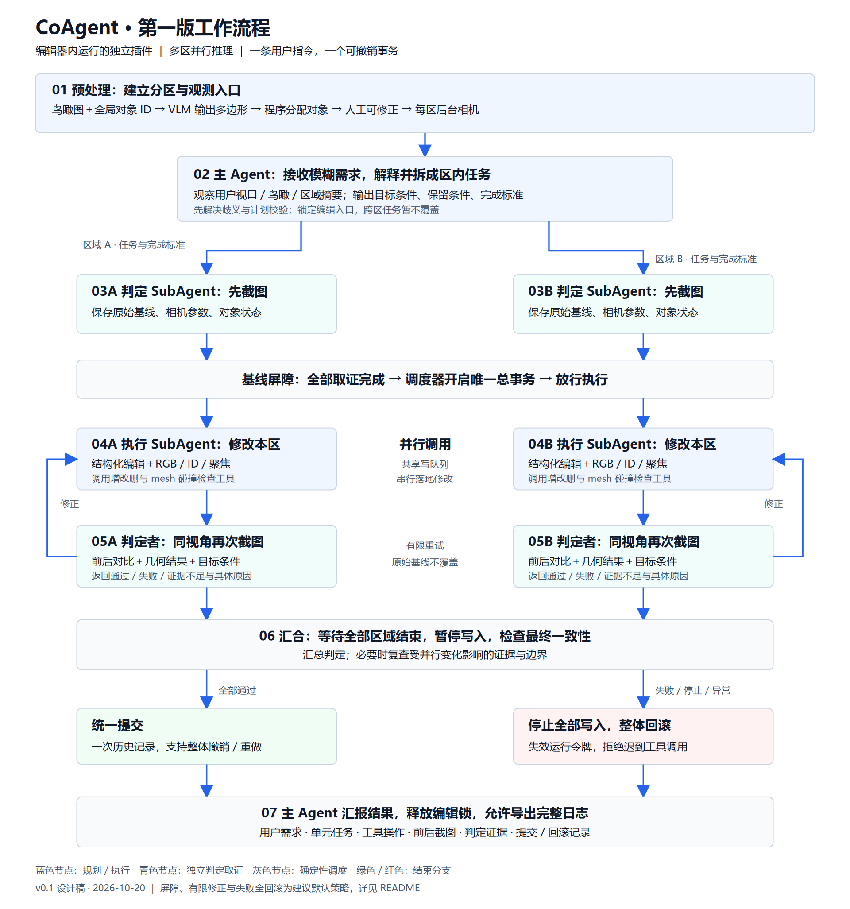

# CoAgent 第一版设计

版本：v0.1 设计稿 · 2026-10-20  
状态：供实现与讨论使用，尚未实现插件。本次仅新增设计文档与流程图。

**开发入口：请优先阅读 [DEVELOPMENT-SPEC.md](./DEVELOPMENT-SPEC.md)。** 该文档定义整体架构、模块职责、通信、外部依赖、逐步开发与测试计划、SubAgent 分工。选型背景见 [TECHNICAL-PLAN.md](./TECHNICAL-PLAN.md)。若早期建议冲突，以 DEVELOPMENT-SPEC.md 为准；业务流程与前后截图判定顺序不变。

## 1. 目标与已确认需求

CoAgent 是 3D-Layout 中独立启用的大插件，与现有插件一样运行在编辑器前端，不要求另起 Python Agent 服务。第一版优先跑通完整流程，不以证明算法优越性为前提。

用户直接输入模糊意图，例如“把村落分布得更稀疏”。主 Agent 负责理解、歧义消解和目标拆解，不要求用户预先编写单元任务。预计处理约 200m 尺度的大陆场景，具体场景、对象数与层级尚未确定；相机尺度必须来自场景包围范围而非固定房间尺寸。

已确认：

- 鸟瞰图与对象 ID/最小结构化对象表共同输入 VLM；VLM 决定分区数量及地面多边形，程序由多边形确定对象集合。
- 允许人工修改分区。第一版暂不研究单张鸟瞰图遮挡、多楼层等问题，但必须记录未覆盖和无法分配的对象。
- 每个分区配置独立后台相机；相机可以移动。主 Agent 也能观察用户当前视口。
- 子 Agent 采用结构化编辑与视觉校验；观测包括 RGB、ID 标记、局部聚焦。
- 任务由主 Agent 输出目标条件，执行者通过工具求解；新增资产仅来自现有模型库。
- 不同分区并行工作；一条用户指令形成一个可撤销事务。执行时禁止用户手动修改场景。
- 用户暂时不会提供跨区任务；跨区协调不在第一版范围内。这不是对未来任务能力的永久限制，也不能将跨区需求自动改写为区内需求。
- 重点提供可导出的日志，不建设复杂的多 Agent 可视化工作台。
- 采用用户提出的顺序：主 Agent 下发任务 → 判定 SubAgent 编辑前截图 → 执行 SubAgent 修改 → 判定 SubAgent 再次截图并判定。

## 2. 工作流程



[打开 SVG 矢量图](./workflow.svg)。图中展示两个区域作为示例，实际区域数由预处理决定；并行数量受配置限制。

### 2.1 预处理

1. 等待场景与必要资产加载完成，读取当前内存场景，不依赖上次磁盘保存状态。
2. 分配稳定全局对象 ID，复用现有 `asset.id`，禁止截图重新编号后失去映射。
3. 按 XZ 地面建立鸟瞰正交相机，保存像素到地面坐标的变换；输出原始图、ID 标记图及对象简表。
4. VLM 返回 `region_id/name/polygon_xz/description`。多边形坐标使用世界米制；程序校验有限数值、简单多边形、面积和场景范围。
5. 程序按对象地面锚点确定主归属；多重命中和无命中进入异常列表，由修正流程处理，不静默丢弃或任意分配。
6. 支持人工改名、调整多边形及重新计算归属。对象分组的权威依据为最终多边形与明确的边界裁决，不能另存一份与之矛盾的手工集合。
7. 为每区生成默认观察相机，保存配置。区域确认后进入就绪态。

建议默认：归属锚点使用世界包围盒底面中心；这只是归属规则，不保证整个 mesh 位于区域内。边界大物体、地形等可标为共享只读背景。对象分组规则和共享背景名单需要实现时以实际场景确认。

### 2.2 主 Agent 规划

主 Agent 的初始观测包包含：用户请求、当前用户视口截图及相机、标记鸟瞰图、区域摘要、对象 ID 索引。按需读取区域对象表或区域截图，不默认塞入全部高分辨率图像与全场对象详情。

它将模糊意图转成区域内目标条件、可操作对象范围、保留条件与完成标准。例如“村落更稀疏”必须区分村内建筑间距和不同村落之间的距离。若歧义影响任务范围，主 Agent 先澄清；若识别出跨区任务，标记当前不支持，不擅自换成另一个目标。

主 Agent 输出计划后，程序检查：引用对象存在、区域存在、依赖无环、写集合不冲突、没有跨区转移、所需资产在库中。第一版同一区域内任务顺序执行，不同区域并行；任务列表允许前序新增对象的结果引用。

### 2.3 判定者编辑前取证

每区创建执行者与只读判定者，两者接收相同任务及完成标准。判定者先读取对象状态、选择证据视角，并拍摄：

- 固定基线 RGB 与 ID 标记图；
- 必要的目标细节图；
- 初始几何检查结果与目标相关的结构化量。

判定者保存相机参数、视场/投影模式、分辨率、对象映射、场景 revision 和截图 ID。不可满足或无法验证的任务先反馈主 Agent，不能先编辑再临时改变完成标准。

**第一版增加全局基线屏障：全部受影响区域的初始证据就绪后，才允许任何执行者修改。** 这仍遵守每区“先截图后执行”的顺序，同时避免其它并行区域提前编辑污染原始证据。

### 2.4 并行执行与再次判定

调度器建立唯一总事务，将句柄仅留在工具执行层。执行者并行进行模型调用、区域观测与推理；实际场景写入经过一个串行命令队列。每个执行者可调用对象查询、模型库查询、截图、聚焦、相机调整、增改删与 mesh 碰撞工具。

执行者不能调用 `edit.begin/commit/rollback`，不能修改工具白名单或绕过区域作用域。工具调用带 `run_id/task_id/tool_call_id`；写操作校验对象版本，重复调用返回先前结果而非重复新增。写入时再检查一次任务是否仍有效。

判定者在本区执行完成后，使用**与基线一致的相机配置**再次拍摄，并检查目标条件、保留条件和几何约束。补充视角可以新增，但不能拿不同视角冒充严格前后对比。原始基线在修正轮次中保持不变。

判定结果为 `pass/fail/uncertain`，附证据 ID、逐项标准结果和修正建议。判定者不改场景；执行者按反馈修正后再接受判定。自述“已经完成”不能替代证据。

若邻区可见内容或共享场景 revision 在取证中变化，记录实际版本；最终全部执行者停止后，重新检查受影响的边界与证据。第一版无跨区任务不等于渲染上完全没有邻区，也不等于可以忽略边界碰撞。

### 2.5 汇总、提交与失败

建议默认：全部任务通过且最终一致性检查通过后，调度器提交总事务，主 Agent 汇报结果；无需每个子任务单独人工接受。保留停止按钮。

任何区域终止失败、用户停止、插件关闭或不可恢复异常：先撤销运行令牌、停止接收新写入、等待/清空命令队列，再整体回滚，避免晚到的网络响应在回滚后继续修改。已完成区域也不单独提交。此“失败全回滚”是第一版建议默认值，可后续讨论部分成功策略。

最终判定阶段所有执行写入暂停。主 Agent 可做语义汇总，但不能覆盖失败的几何约束强制提交。无操作的指令返回 no-op，不产生空历史。

## 3. 角色与职责

| 角色 | 输入与职责 | 权限 |
|---|---|---|
| 主 Agent | 用户交流、全局摘要、需求解释、任务拆解、结果汇报 | 全局只读观测与任务调度；不直接编辑 |
| 执行 SubAgent | 区内任务、对象表、镜头、反馈；求解目标条件 | 区内增改删、查询、相机、碰撞检测 |
| 判定 SubAgent | 原任务、保留条件、基线与后验观测 | 区内只读观测和检查，无编辑权限 |
| 确定性调度器 | 状态机、并发、屏障、预算、取消、事务 | 唯一事务所有者 |
| 工具与渲染桥 | 参数校验、ID 映射、渲染、几何、实际写入 | 使用现有 core 接口，隔离模型输出 |

“Agent”是独立提示词/会话上下文，不等于一个服务或进程。每区的执行与判定可以复用同一模型配置，但上下文分开。任务结束后丢弃临时对话，保留主 Agent 下发的任务及状态；完整对话仅作为日志，不自动回灌下一轮。

## 4. 数据契约草案

以下接口是设计草案，不是当前代码中已存在的 API。

```ts
type Region = {
  id: string;
  name: string;
  polygonXZ: [number, number][];
  assetIds: string[]; // 从多边形和边界裁决派生
  cameraId: string;
  partitionVersion: number;
};

type UnitTask = {
  id: string;
  regionId: string;
  goal: string; // 目标条件，不强制主 Agent 输出最终坐标
  operation: "add" | "modify" | "remove" | "composite";
  targetIds: string[];
  referenceIds: string[];
  selectionIntent?: string; // 目标未定时在本区解析
  constraints: string[];
  acceptance: { id: string; description: string;
    kind: "geometry" | "visual" | "semantic" }[];
  dependsOn: string[];
};

type Observation = {
  id: string;
  runId: string;
  taskId: string;
  sceneRevision: number; // 内存编辑版本，不等同磁盘保存版本
  cameraSnapshot: CameraConfig;
  captureGroupId: string;
  rgbRef: string;
  markedRef: string;
  visibleAssetIds: string[];
  objectSnapshotRef: string;
};

type Verdict = {
  status: "pass" | "fail" | "uncertain";
  criteria: { id: string; status: "pass" | "fail" | "uncertain";
    evidenceIds: string[]; reason: string }[];
  corrections: string[];
};
```

`CameraConfig` 实现时包含投影类型、position、target、up、fov 或正交范围、near/far、输出宽高。截图文件引用由工具层解析成真实模型图像输入，不能只把路径作为文字发送。

任务依赖示例：先新增房屋获得 `newHouseId`，后续任务引用该结果；不能由模型编造未创建的 ID。第一版只支持同区依赖，不支持跨区依赖图。

## 5. 插件与现有项目的接入

2026-10-20 阅读代码确认的事实：

- `src/App.tsx` 直接装配侧栏插件与 module hook；没有必要假设存在动态安装插件 SDK。
- `src/modules/agent/tools.ts` 已有工具注册、参数校验、结构化场景描述与编辑接口，可作为复用依据，但不能直接把全局权限原样暴露给执行者。
- `src/core/engine.ts` 提供当前视口截图、归一化点选、对象聚焦；尚未提供此设计所需的完整独立相机观测 API。
- `src/core/edit.ts` 使用单一 `openTx`。各 SubAgent 自行 begin 会覆盖当前事务；必须由 CoAgent 独占一个总事务。
- 当前 `App.tsx` 的人工编辑禁用条件仅关联原 Agent 的 phase。CoAgent 还需要统一编辑忙碌状态，拦截撤销/重做、场景切换、导入及旧 Agent 写入等入口，不能仅隐藏 gizmo。
- 当前依赖表没有 LangGraph。本设计不增加依赖或服务，只提出实施边界。

建议目录：

```text
src/modules/coagent/
  CoAgentPanel.tsx        # 开关、输入、进度、停止、日志导出
  useCoAgentModule.ts     # 生命周期与取消
  orchestrator.ts        # 状态机、并发、基线屏障、总事务
  protocol.ts            # Region / UnitTask / Observation / Verdict
  preprocessing.ts       # 鸟瞰、VLM 分区、校验、归属
  mainAgent.ts           # 全局规划
  executorAgent.ts       # 区内执行
  judgeAgent.ts          # 前后取证与判定
  tools.ts               # 分角色白名单与作用域检查
  observation.ts         # 观测包与快照索引
  recorder.ts            # 可导出日志
```

渲染桥与几何工具通过 core/渲染层增加明确能力，CoAgent 不直接操作任意 three 对象。旧 Agent 的模型配置和传输逻辑可评估抽取为共享层；避免新插件依赖旧 Agent 的会话 store，避免复用产生两个事务所有者。

### LangGraph 取舍

用户已明确按现有插件方式运行，因此不采用额外 Python 服务。后续讨论确定采用 LangGraph JS 作为第一版编排路线，先进行 Vite 浏览器兼容性验证；详细模块边界、状态与事务设计见 TECHNICAL-PLAN.md。框架不自动解决场景事务、截图一致性与权限问题。

## 6. 镜头、区域和几何工具

后台相机共享场景资产、使用独立相机配置与离屏渲染目标，不改变用户视口。主 Agent 的用户视口截图也记录精确姿态。相机快照不进入场景编辑历史。

RGB 和 ID 标记图从同一场景 revision 与同一相机生成；截图期间短暂阻止写队列执行，等待目标资产加载并完成渲染同步。共享 WebGL 上下文的截图请求排队，不假设 GPU 渲染能任意并行；渲染状态在 finally 中恢复。

第一版工具建议：

| 工具 | 用途 |
|---|---|
| `scene.get_overview / viewport.capture` | 主 Agent 全局摘要与用户视口 |
| `region.get_state / asset.get / catalog.search` | 区域信息、对象与模型库 |
| `camera.observe / camera.focus / camera.set_pose` | RGB＋ID、聚焦与镜头移动 |
| `asset.add / asset.set_transform / asset.remove` | 经作用域与总事务校验的写入 |
| `geometry.check_collisions` | 返回对象对、检测精度、容差与判定 |
| `geometry.measure` | 距离、包围范围等可验证量 |

碰撞检查采用宽阶段包围体筛选与窄阶段 mesh/BVH 检测；具体库与实现另行选型。三角面相交不覆盖闭合实体完全包含，应另行检测或返回 unknown；接地、允许接触、非封闭 mesh 和地形需要明确策略。结果使用 `clear/collision/unknown`，不能把 unknown 当通过。约 200m 地形建议作为静态背景单独处理。

同一轮冻结分区；不自动重分区。新增对象进入所选区域，移除对象清理派生集合。撤销、重做、回滚后由当前场景重新计算归属，不能留下失效标签。标签初版存插件派生映射，不新增无法被现有事务回滚的永久字段。

运行期间程序可拒绝明确越区的操作并反馈“第一版不支持”；这只是作用域保护，不是跨区协调算法。静态邻区障碍仍可由几何工具检查，无须让 SubAgent 获得跨区编辑能力。

## 7. 建议默认值与未决项

下表为实现建议，不是用户已确认的要求；做成配置，避免散落在提示词中。

| 项目 | 第一版建议 |
|---|---|
| 区域并发数 | 2，后续按 API 限流与场景大小调整；同区串行 |
| 修正轮数 | 每任务首次执行后最多额外修正 1 次；耗尽后整轮失败回滚 |
| 工具调用预算 | 每任务含修正最多 30 次；超限返回明确原因 |
| 单次模型请求超时 | 120 秒；日志记录超时，写操作不得盲重试 |
| 完成提交 | 全部通过后统一提交；停止或终止失败整体回滚 |
| 主 Agent 歧义处理 | 不影响范围的细节可作明确假设；影响目标/范围时询问 |
| 背景对象 | 地形等共享只读，具体名单按场景确认 |
| 保存场景 | 仅在总事务提交后调用现有保存能力，沿用部署环境行为 |

尚需实际场景验证：对象粒度是否与 `asset.id` 一致；村落是多个独立建筑还是一个合并 mesh；地面高度和尺度；区域边界规则；碰撞精度与耗时；模型多图输入和并发限额。上述信息不足不阻止先完成插件骨架与模拟执行器。

## 8. 日志与复现

建议一次导出一个 ZIP，包含 `run.json`、`events.jsonl`、`observations/`、`verdicts/`、`edits.json`、`summary.md`。实现时可选择打包依赖；日志导出不是新增独立后台服务。

记录：用户请求、主 Agent 任务、分区与相机配置、场景/对象版本、模型及请求参数、可获得的 usage、每次工具参数与结果、截图文件、判定依据、修正、取消、提交或回滚。事件包含 `run_id/task_id/region_id/agent_role/event_seq/time`，便于重建并行时间线。

禁止导出 API Key、Authorization 请求头或浏览器凭据。保留模型实际响应与工具证据，不要求或伪造模型隐藏推理。图片必须随包导出，不能只存失效的 blob URL。导出包用于审阅；不承诺模型重新运行可逐字复现。

## 9. 实施顺序与验收

1. 插件开关、全局编辑锁、总事务、模拟主 Agent/执行者/判定者、日志导出。
2. 独立后台相机、同视角前后截图、RGB＋ID 标记与聚焦。
3. 鸟瞰 VLM 分区、多边形校验、对象归属、最小人工修正入口。
4. 接入真实主 Agent 与区内执行/判定，允许两个区域模型并行调用。
5. 加入几何检测、有限修正、失败与取消回滚、旧插件互斥。

验收必须覆盖：模糊输入能生成目标条件任务；所有 baseline 早于首次写入；判定者确实独立复拍；不同区域有并行调用记录；一条指令仅产生一条历史；停止后无迟到写入；任一区失败恢复全部修改；撤销/重做标签一致；旧 Agent 与人工操作无法抢写；导出日志包含可打开的前后图片。

## 10. 后续研究边界

跨区协作、动态重分区、真实多楼层与遮挡补拍、长期 Agent 记忆、执行中人机协同、复杂物理可行性、学习式相机调控不属于第一版验收范围。第一版不以“支持全场任意编辑”对外描述。

可借鉴的论文线索（来自前期调研，非本插件已复现结果）：[SeeGround](https://arxiv.org/abs/2412.04383) 的标记图与结构化对象对应；[GPT4Scene](https://arxiv.org/abs/2501.01428) 的全局/局部 ID 对应；[ScanEdit](https://arxiv.org/abs/2504.15049) 的局部编辑与几何约束；[CoV](https://arxiv.org/abs/2601.05172) 的观察反馈循环。具体实现不依赖这些论文的全部模型。
