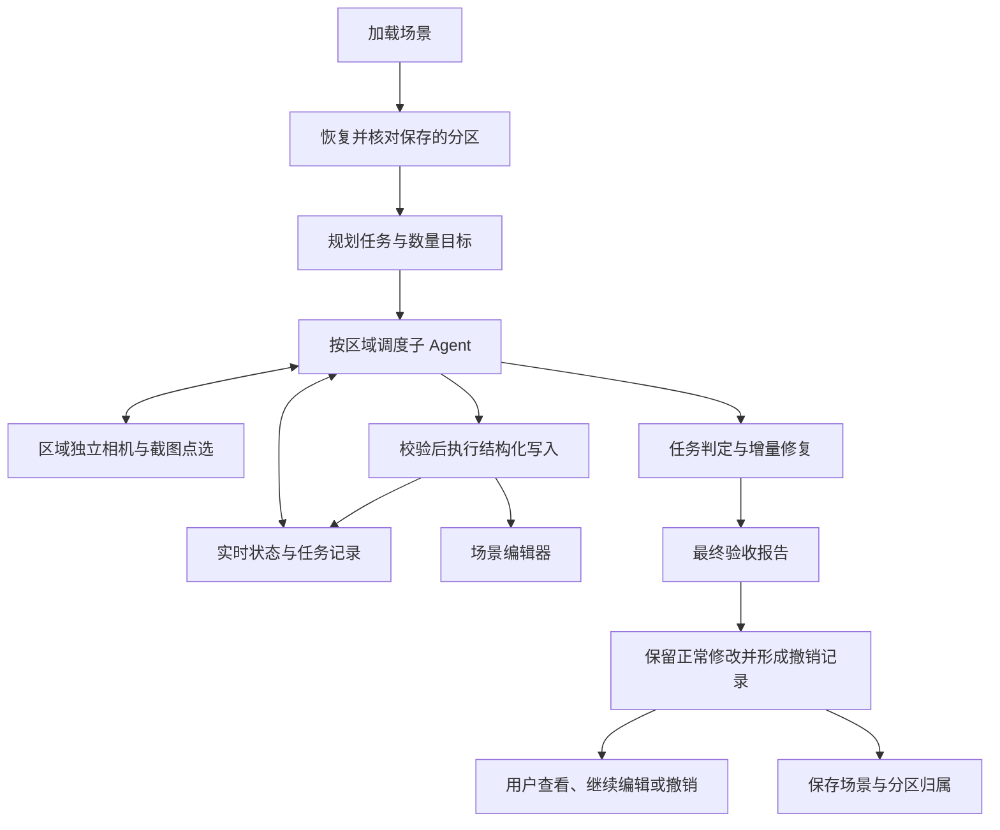
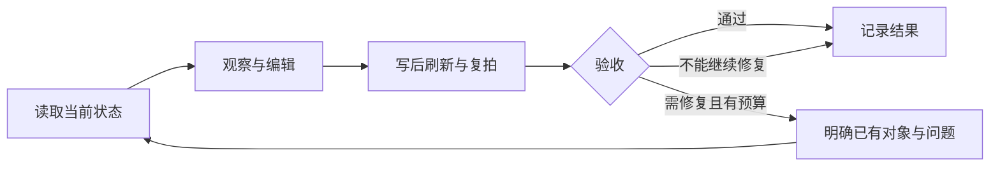

# 修订后的架构与工作流程

## 1. 用户将看到什么变化

用户打开场景后，系统优先恢复保存的分区，不必每次重新划区。收到“添加几栋房屋”后，各区域 Agent 能查看自己的区域、靠近房屋、绕到侧面，必要时从截图里点中目标，再用真实对象 ID 修改。

需要修复时，Agent 明确知道哪些房屋已经创建，会调整它们，而不是重新添加。运行结束即使有判据未通过，正常写入的结果也会保留，用户可以查看问题、手动调整或撤销整轮修改。

## 2. 架构保持什么，增加什么

保留“主规划器 + 区域子图 + 判定器”的结构，不新增一套 Agent 框架，也不让模型直接操作 DOM 或 Three 对象。

新增或加强的是组件之间的服务：

| 组件 | 职责 |
| --- | --- |
| 分区持久化适配层 | 保存和恢复分区，与当前场景核对 |
| 运行状态服务 | 记录对象归属、任务写入和修复进度 |
| 区域相机服务 | 独立相机状态、相对调整、截图复拍 |
| 图像拾取服务 | 把截图位置转换为真实对象 ID |
| 统一写入入口 | 权限、数量、指纹、边界、幂等和写后登记 |
| 判定与终检 | 说明哪些条件满足，哪些有问题 |
| 结果控制器 | 保留正常修改、结束事务、保存和关联撤销历史 |

## 3. 一次任务如何执行

1. 冻结本轮分区边界和权限基础，读取当前场景。
2. 规划器给出任务、数量目标、依赖和判据；程序校验。
3. 每个任务建立修改前基线，初始化自己的写入记录。
4. 区域 Agent 根据实时数据观察和编辑。已知 ID 直接使用；视觉定位不清时可以点选。
5. 每次成功写入立即登记，查询随后就能看到变化。
6. 拍摄当前结果并验收；需要修复时传入当前对象和未解决问题。
7. 修复预算用完则记录问题，不无限循环。
8. 正常结束后提交一条整轮撤销记录，显示验收结果。

## 4. 三个必须分开的概念

### 4.1 区域边界与实时成员

边界在运行中固定，对象状态持续变化。不能拿运行开始的成员列表冒充实时查询，也不能让模型通过移动对象获得跨区权限。

### 4.2 自由观察与验收证据

工作相机允许自由调整；验收保留固定的前后对比，并补充局部图片。新增对象必须优先进入标注和局部观察。

### 4.3 验收通过与修改保留

“已经保留”不等于“任务全部完成”。未通过项必须真实显示。程序错误导致事务不可信时，仍需异常恢复；普通视觉不满意不再自动删除成果。

## 5. 并行与权限

不同区域可以并行进行模型推理，各自有相机状态；共享场景写入与渲染资源受调度。用户主视口不跟着 Agent 转动。

同区仍按任务顺序和依赖执行。首版允许沿用失败后停止本区的行为，但必须明确列出未执行任务。独立任务继续执行属于后续增强。

点选只是识别对象，不会授予编辑权限。跨区和全局只读对象可以被看到，但不能因此被修改。

## 6. 分区长期保存如何融入

`scenes/<sceneId>/coagent/partition.json` 保存边界、稳定区域 ID、对象归属来源和场景指纹。加载后核对当前场景，生成现有 `PartitionSnapshot`，规划器和区域子图不需要了解存储格式。

正常保存、Agent 结果保留和用户撤销后，归属与场景同步核对。分区持久化不保存活跃事务、旧写权限或任务证据。
