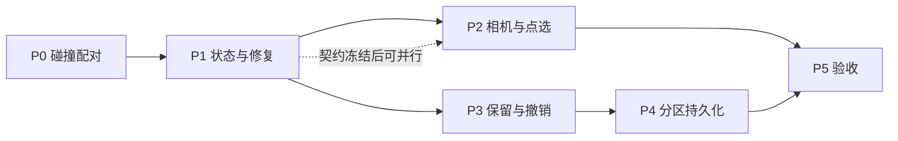

# 实施任务分解（2026-10-27）

本文件把 [02](02-目标架构与流程.md)–[08](08-测试与交付清单.md) 的方案拆成可执行任务卡。前置基线见 [baseline/BASELINE.md](baseline/BASELINE.md)：**298 用例全绿、构建通过、无既有失败**，因此下文任何新增失败都可归因于本轮改动。

源码路径相对仓库根（`G:\GraduateDesign\Softwares\3D-Layout`），行号基于 HEAD `288a222` + 用户未提交改动。

## 1. 完成定义（DoD）

一个任务算完成，必须同时满足：

1. 契约、真实 adapter、fake、UI 投影、日志五个消费者同步改动（只改 TS 联合类型必然漏 UI）。
2. 有对应测试，且**测试断言行为而不是断言实现字段**。
3. `pnpm test:coagent` 全绿且**用例数不少于基线 298**。
4. 涉及视觉效果/相机的任务，另有浏览器实跑记录（不能只靠 FakeRender）。
5. 在 [IMPLEMENTATION-STATUS.md](../IMPLEMENTATION-STATUS.md) 记录改动文件、失败语义、未覆盖项。

## 2. 契约冻结清单（先行，最高杠杆）

以下类型是 P1–P4 的公共地基，**建议先一次性定稿再分头实施**，否则会出现三套成员算法。

| 位置 | 变更 | 影响消费者 |
| --- | --- | --- |
| `contracts.ts:85` `UnitTask` | 增 `creationTarget?: { minCount: number; maxCount: number }` | schemas、planValidation、planner、executor、validation、fixture |
| `contracts.ts:563` `TaskResult` | 增 `liveCreatedObjectIds`、`removedObjectIds`；`createdObjectIds` 保持审计语义不变 | mainGraph、validation、judge、uiProjection、runLog |
| `contracts.ts:583` `FinalCheckItem` | `passed: boolean` → 增 `outcome?: 'pass' \| 'fail' \| 'uncertain'`（保留 `passed` 兼容） | validation、mainGraph、UI |
| `contracts.ts:599` `RunOutcome` | 增 `{ kind: 'retained_with_issues'; ... 同 completed 字段; issues }` | mainGraph、runController、uiProjection、uiStore、面板、进度、图页、日志 |
| `contracts.ts:712` `CoAgentPhase` | 增 `retained`（不得进 `ACTIVE_PHASES`，见 `runController.ts:84`） | uiProjection、uiStore、面板、hostLocks、图页 |
| `contracts.ts:636` `WorkflowContext` | 增 `runState`（窄接口）、`pick`、`regionViews` | regionGraph、tools、executor、fakeContext |
| `contracts.ts:502` `EditorWritePort` | `commitRun` 改为返回回执 | writeFacade、editorAdapter、FakeEditor、runController |
| `ERROR_CODES` | 增 `task_creation_limit`、`stale_observation` | schemas、editTools、cameraTools、UI 文案 |
| `TOOL_NAMES` | 增 `camera.overview/inspect/adjust/restore`、`scene.pick` | schemas、registry、prompts、FakeModel、directorModel |
| `config.ts` | 增 `maxImagesPerRequest`、`cameraWorkWidth/Height`、`cameraDetailWidth/Height`、`maxShotsPerTask`、`maxCreationsPerTask` | 所有上限必须有限（现有约定） |

> `RunOutcome` 当前只有 `completed / needs_clarification / rolled_back / cancelled`（`contracts.ts:599-610`），**没有 `write_failed`**；文档里提到的 `write_failed` 实际表现为 `rolled_back` + `reason: ToolError`。实施 P3 时按实际代码走，不要凭文档加不存在的分支。

## 3. 任务总览

| 任务 | 阶段 | 标题 | 依赖 | 规模 |
| --- | --- | --- | --- | --- |
| T0-1 | P0 | 碰撞配对范围收窄 | — | S |
| T0-2 | P0 | 覆盖不足显式化 | T0-1 | S |
| T0-3 | P0 | 几何测试补齐 | T0-1,T0-2 | S |
| T0-4 | P0 | 改动 1 回归确认 | — | XS |
| T0-5 | P0 | 场景切换清空分区（新发现的独立缺陷） | — | S |
| T1-1 | P1 | 契约：creationTarget / ledger / 错误码 | 冻结清单 | M |
| T1-2 | P1 | schemas 校验 creationTarget | T1-1 | S |
| T1-3 | P1 | planValidation 强制新 add 计划带数量目标 | T1-1 | S |
| T1-4 | P1 | planner/prompts 产出结构化数量 | T1-3 | S |
| T1-5 | P1 | 归属纯函数（唯一成员算法） | T1-1 | M |
| T1-6 | P1 | `runtime/runState.ts` 台账服务 | T1-5 | L |
| T1-7 | P1 | 写入原子路径改造 | T1-6 | L |
| T1-8 | P1 | 查询工具实时化 + sceneRevision | T1-5 | M |
| T1-9 | P1 | validation 接同一 resolver + 数量检查 | T1-8 | M |
| T1-10 | P1 | executor `executionState` 与修复提示 | T1-6 | M |
| T1-11 | P1 | regionGraph 任务隔离生命周期 | T1-6,T1-10 | M |
| T1-12 | P1 | fake 与 fixture 同步 | T1-1..T1-11 | M |
| T1-13 | P1 | 测试 S01–S14 | 全部 P1 | M |
| T1-14 | P1 | 执行期证据按任务切分（新发现缺陷） | T1-6 | S |
| T2-1 | P2 | 契约：相机/拾取/图片窗口 | T1-1 | M |
| T2-2 | P2 | `services/regionCamera.ts` 相机数学 | T2-1 | M |
| T2-3 | P2 | `runtime/regionViews.ts` 每区状态 | T2-2 | S |
| T2-4 | P2 | 相机工具族 + 旧工具兼容 | T2-3 | M |
| T2-5 | P2 | 截图尺寸与队列时序 | T2-4 | M |
| T2-6 | P2 | 离屏拾取 + `scene.pick` | T2-5 | L |
| T2-7 | P2 | 模型图片有界窗口 | T2-1 | M |
| T2-8 | P2 | judge 附图与标注优先级 | T2-7 | S |
| T2-9 | P2 | 测试 C01–C12 + 浏览器套件 | 全部 P2 | L |
| T2-10 | P2 | 证据按 run 释放（新发现缺陷） | T2-1 | S |
| T3-1 | P3 | 契约：保留终态与撤销引用 | T1-1 | M |
| T3-2 | P3 | mainGraph 不再把普通失败变回滚 | T3-1 | S |
| T3-3 | P3 | 提交回执（commit 真验证） | T3-1 | M |
| T3-4 | P3 | 事务查询与撤销能力核实/扩展 | T3-3 | L |
| T3-5 | P3 | runController 终态处置序列 | T3-2,T3-3 | M |
| T3-6 | P3 | 撤销 API 与按钮 | T3-4,T3-5 | M |
| T3-7 | P3 | 终态穷举分支同步 | T3-1,T3-5 | M |
| T3-8 | P3 | 测试 R01–R10 | 全部 P3 | M |
| T4-1 | P4 | `services/partitionPersistence.ts` 契约与校验 | T1-5 | M |
| T4-2 | P4 | 场景内容指纹 | T4-1 | S |
| T4-3 | P4 | 加载核对（复用 T1-5） | T4-1,T4-2 | M |
| T4-4 | P4 | IO adapter 与 middleware | T4-1 | M |
| T4-5 | P4 | 生命周期与来源标志 | T4-3,T4-4 | M |
| T4-6 | P4 | 保存链一致性 | T4-5,T3-5 | M |
| T4-7 | P4 | UI 持久化状态 | T4-5 | S |
| T4-8 | P4 | 测试 P01–P12 | 全部 P4 | M |
| T5-1 | P5 | 原请求端到端复现 | 全部 | L |
| T5-2 | P5 | 全量回归 + 构建 + 浏览器 | T5-1 | M |
| T5-3 | P5 | 真实模型运行与记录 | T5-2 | M |
| T5-4 | P5 | 文档回填 | T5-3 | S |

规模：XS ≤ 30 分钟，S ≤ 2 小时，M 半天，L 一天以上。

## 4. P0 任务卡

### T0-1 配对范围收窄

**现状**：`rendering/geometry.ts:644-672` 把 `request.objectIds` 与 `request.staticObjectIds` 合并成 `allIds` 后做**全量 i<j 两两配对**，静态×静态也在其中。样本日志的 561/630 对即由此产生。

**改动**：

```
targets = request.objectIds（本任务新增/修改/目标）
statics = request.staticObjectIds（当前场景其他相关对象）
检查 targets×targets（去重）+ targets×statics
不检查 statics×statics
```

**约束**：`checkPair`、`allowGroundContact`、`maxTrianglesPerObject`、预算逻辑全部不动——只改配对集合的构造。

**验收**：现有 `tests/unit/geometry.test.ts` 11 个用例继续通过；这些用例都是「1 target + 1 static」，`pairs[0]` 仍须是 target×static 对，改配对循环时不能破坏顺序假设。

### T0-2 覆盖不足显式化

**现状**：`geometry.ts:648` 超过 64 对象直接返回 `{ status: 'unknown', highestLevel: 'aabb', pairs: [] }`，既不说明被跳过的是谁，也不区分"检测为 unknown"与"压根没检测"。

**改动**：`GeometryResult` 增覆盖报告（参与检测的 ID、被排除的 ID 及原因、是否因预算截断）。硬性零碰撞判据遇到覆盖不足**不得返回 clear**。

**验收**：G05——候选超预算返回 unknown/覆盖不足，不伪报 clear。

### T0-3 几何测试补齐

新增断言（当前 `tests/unit/geometry.test.ts` 11 条中**没有一条**覆盖这些）：

1. 两个静态对象互相穿插 + 一个目标对象正常 → 结果 clear，且 `pairs` 里不含 statics×statics。
2. 目标与静态穿插 → collision（回归）。
3. 超 64 对象 → unknown 且覆盖报告列出被排除对象。
4. 三角形预算截断 → unknown，不静默丢对象。
5. `allowGroundContact` 地面支撑放行（G03 回归）。

### T0-4 改动 1 回归确认

不写代码。确认 `no_collision.basis` 链路（`contracts.ts` 可选 basis、`schemas.ts` 来源校验、`planValidation.ts:159-170` 原文引用校验）在 T1-1 契约变更后仍通过：G01（不默认零碰撞）、G02（伪造引用被拒）。

## 5. P1 任务卡

### T1-1 契约

- `UnitTask.creationTarget` 可选，新 add 计划强制有值。
- `TaskResult` 增 `liveCreatedObjectIds` / `removedObjectIds`，`createdObjectIds` 保持"累计创建历史"审计语义——**不得悄悄改变旧字段含义**（有 finalCheck 消费者）。
- `ERROR_CODES` 增 `task_creation_limit`（附 current/max/liveCreatedIds 与建议）。

### T1-2 / T1-3 / T1-4 数量目标三件套

schemas 校验（整数非负、min≤max、规模上限）；`planValidation` 在 `policy` 路径（新计划）强制 add 必填，**禁止从 `region.object_count` 或 objective 正则推导**；planner/prompts 让它把"几栋"落成具体 `minCount/maxCount` 并写进 `assumptions`。旧计划解析必须仍然合法（字段可选）。

### T1-5 归属纯函数

新建共享纯函数（建议 `services/ownership.ts`），三处唯一来源：

```
regionMembers       = (初始归属 ∪ 本轮该区创建) ∩ 当前存在
writableMembers     = regionMembers - readonly - unresolved
taskWritableMembers = writableMembers ∩ 当前任务允许对象
```

P4 的恢复核对必须复用这三个函数，**不许写第四套**。

### T1-6 runState 台账

`runtime/runState.ts`：`ObjectOwner` + `TaskLedger`（`createdIds/modifiedIds/removedIds/appliedReceiptKeys/phase/attempt`）；方法 `registerTasks` / `resolveRegion` / `getTaskSnapshot` / `validateWrite` / `recordReceipt` / `finish`。生命周期归 `runController` 所有，经 `WorkflowContext` 暴露窄接口。

**关键**：`regionGraph` 不再持有第二份权威写集。当前 `runController.ts:197-203` 在 run 开始构建一个 `writable` Set，`279` 行只加不减——这套要迁移进 runState，避免三份集合并行演化。

### T1-7 写入原子路径

`runController.ts:264-281` 的 `applyWrite` 现在**只在入队前**检查 `abort.signal.aborted`（266 行），入队后直接 `applyAuthorized`。`scheduler.runScene` 是 promise 链（`scheduler.ts:79-84`），排队期间被取消不会有任何拦截。

改为队列内顺序：

```
入队 → 队列内再查 abort / run·scene 身份 / token
    → 幂等命中已有回执？直接返回（在名额检查之前！）
    → 取当前快照 → 权限、归属、只读、数量、边界
    → applyAuthorized（保留指纹与底层幂等）
    → 成功后登记 ledger + 可写集合 + 回执
```

红线：`scheduler.ts:5-6` 明确"网络请求绝不能占据该队列"，登记必须是同步的本地操作。

### T1-8 / T1-9 查询与验收同源

`tools/sceneTools.ts:25-27` 现在用冻结的 `region.objectIds.length` 当数量；`services/validation.ts`（617 行，最大文件）又按全场坐标另算。改为两边都接收 T1-5 的 resolver 结果，查询响应带 `sceneRevision`，`objectCount` 与返回的 `objectIds.length` 严格一致。

新增程序生成的 `task-created-count:<id>` 检查，采用**存活新增数**，模型不能推翻。

### T1-10 executor 修复上下文

`ExecutorInput` 增 `executionState`（Phase、attempt、sceneRevision、目标数量、存活新增、`remainingAddCapacity`、本任务对象及其当前 transform/fingerprint、已删除摘要、允许对象、`taskBeforeObservationId`、`latestObservationId`、未通过判据）。修复提示必须明说"上一轮修改仍保留"。

现状问题：修复建新对话只带原任务和文字反馈，而原任务仍写"新增两栋"，模型因此再新增两栋。

### T1-11 regionGraph 生命周期

`workflow/regionGraph.ts`（357 行）五个节点：prepare 建基线与观察状态、**禁带上任务写集**；execute 读 task snapshot；judge 用存活对象；repair 更新 phase/attempt 并保留同一 ledger；advance 清本任务临时证据；`finishFail` 保留本区已完成任务 + 显式 skipped（`dependency_failed` / `region_stopped`）——现在只返回 `[failed]` 会丢掉历史成果。

### T1-12 fake 同步

`tests/fakes/`：`fakeContext.ts` 接新 `WorkflowContext` 成员；`FakeRender.ts:112` 的 `[...objectIds, ...staticObjectIds]` 合并逻辑要跟着 T0-1 改，否则 fake 与真实实现语义分叉；`FakeEditor` 接 commit 回执；`FakeModel`/`directorModel` 加新工具名；`fixtures/twoRegionScene.ts` 的任务要带 `creationTarget`。

### T1-13 测试

S01–S14 全量（见 [08](08-测试与交付清单.md) §2）。重点：S04 第三次 add 被拒且**无场景副作用**；S07 两个新增争最后名额只一个成功；S08 幂等重放返回原 ID 不计名额；S10 排队中取消后作业开始被拒；S14 新 run 不残留旧 ledger。

## 6. P2 任务卡

### T2-1 契约

`CameraSnapshot`（`contracts.ts:109`）扩展工作相机字段；`TOOL_NAMES` 增 5 个工具；`RenderPort`（`contracts.ts:408`）增 `pick` 作为**可选能力**——未实现时必须返回明确 `unavailable`，不能返回空命中伪装正常。

### T2-2 相机数学

`services/regionCamera.ts` 纯计算：`offset = d·[cos(e)sin(a), sin(e), cos(e)cos(a)]`，约定 `a=0` 从 +Z 看向中心、正角转向 +X；`zoomFactor<1` 拉近；pan 按画面比例（正右/正上），避免 world Z 正负混淆；俯视正交↔透视切换保留中心与取景尺度；俯仰限值集中配置；距离下限与 near/far 按目标尺度算；参数夹取必须在结果里报实际值与 warnings，**非法参数拒绝而不是产出 NaN 相机**。

### T2-3 / T2-4 每区状态与工具族

`runtime/regionViews.ts` 持 `RegionViewState`（camera/target/focusedObjectIds/viewVersion/latestObservationId）。归属由 tool call 的 runId/regionId 决定，**不接受模型传别区 ID**。新增 `camera.overview/inspect/adjust/restore`，旧 `camera.focus/set/capture` 保持可用（加模式或保留），提示里只暴露一种推荐用法。

**红线**：`cameraTools.ts:37-46` 现在把相机写进 `engine.focusAsset()`——这是改用户主视口；新取景必须走 `rendering/capture.ts` 的 `cameraFromSnapshot`，用户相机/controls/selection 一律不动。

### T2-5 截图尺寸与队列时序

`cameraTools.ts:120-121` 固定 320×240 → 配置化（工作 640×480、局部 960×720 起步，实测调整）。时序按 [05](05-区域相机与视觉点选.md) §5：临界区内完成矩阵更新与捕获、编码在临界区外用已复制的像素、**不得持队列递归入队**（`scheduler.runScene` 是链式 promise，递归会死锁）、异常 finally 恢复 GPU 状态。

### T2-6 离屏拾取

`src/core/engine.ts::pickNormalized` 用主视口相机，不能直接用。抽 `rendererPick(scene, cameraSnapshot, width, height, u, v)`：NDC `x=2u-1, y=1-2v`；raycast 排除编辑辅助件；检查物体与祖先可见性；沿父链找 assetId；返回最前有效命中。`scene.pick` 工具先校验 observationId 属于当前 run/区域、u/v 是 [0,1] 有限数、`observation.sceneRevision === 当前 revision`（否则 `stale_observation` 并提示复拍）。**点选不授予写权限**，空命中是正常结果、不自动吸附。

### T2-7 / T2-8 图片窗口与标注

`executor.ts:94` 的 `toolImages >= 2` 硬上限换成有界最新证据窗口（默认 4 张）：保基线 + 优先最新观察 + 允许同视角前后对；**裁剪在 `modelLoop` 构造每轮请求时重建**，不能靠 `imagesForToolResult` 无限追加（否则 transcript 累积全部图片）。旧图移除后保留文字元数据与 observationId，不破坏 tool call/result 配对。judge 固定 before/after + 最多 2 张相关局部图，**可引用 ID 与实际附图列表分别校验**。`markers.ts` 让新增对象优先进入标注预算（现在"目标/原有/新增"后截前 12 个，本例新增排不进）。

### T2-9 测试

C01–C12。相机数学与消息窗口可单测；截图、拾取、主视口保持、材质遮挡**必须浏览器实跑**。需新增 browser suite 并在 `package.json` 注册，明确启动命令与退出码。

## 7. P3 任务卡

### T3-1 / T3-2 保留终态

`RunOutcome` 增 `retained_with_issues`（共享 completed 的 summary/plan/regions/finalCheck + issues）。`workflow/mainGraph.ts`（505 行）把普通 finalCheck 未通过直接编码成 `rolled_back` 的地方改为 `retained_with_issues`。

**关键区分**：普通判据失败 vs 基础设施错误（读取失败、事务/上下文失效）。不得用一条 `else commit` 把所有异常都提交，也不靠错误文本里有没有 `finalCheck` 判断。

### T3-3 提交回执

现状：`runController.ts:317` 的 `deps.editorWrite.commitRun(token)` 是 **void**，`editorAdapter.ts` 的 `commitTargetTx` 直接 `return true`，`core/edit.ts` 的 `handle.commit` 可能静默 no-op。要做的是让 commit 返回 `{ hasChanges, sceneId, historyTransactionId }` 并**真正验证**提交，不能凭调用成功就宣称有持久历史。

### T3-4 撤销能力（已勘察，结论确定）

**核实结果**：

- `core/edit.ts:162-182` 的 `TxHandle` **有 `readonly id: number`**，就是 transactionId，`core/edit.ts:167-172` 的 `commit()` 把它写进 `Unit.txId`。
- 但这个 id **在整条链路上被吞掉**：`writeFacade.ts:206` 把 tx 存成 `unknown`、`WriteToken`（`contracts.ts:491`）是不透明标记、`EditReceipt`（:477）无 txId、`commitRun` 返回 void。P3 必须新增回执把 id 捞出来。
- 历史栈是数组当栈（`edit.ts:63 journal: Unit[]`），**只支持栈顶操作**。`undoTo(txId)`（:226-233）是"从栈顶连续 pop 到该 txId"，语义 = 撤销该步之后的所有步，**不是选择性撤销某个事务**。
- **没有 `isTop(txId)` / `has(txId)` API**，只能用 `historyUnits().at(-1)?.txId === id` 推断栈顶、用索引差数出"其后有多少编辑"。

**结论**：首版"撤销本轮"= **栈顶撤销**，与 [06](06-验收保留与用户撤销.md) §4 一致；其后有用户编辑则拒绝并给历史入口。不要尝试改 core 做选择性撤销。

**另有三个硬约束**：

1. `edit.begin()`（:180）**直接覆盖未关闭的 openTx**，旧 unit 的修改已生效却永远进不了 journal（不可撤销）。writeFacade 用 `orphanedTxLabels` 记录了这件事——若发生，本轮不能声称"可撤销"。
2. `commit()` 只在 `unit.entries.length > 0` 时 push（:169），`committedRuns++`（`writeFacade.ts:114`）**零写入也会加**，所以"有没有本轮历史"只能用 `armed.tx !== null` 判断，不能用 committedRuns。
3. `undo` 的验证**必须走真实 core**（参照 `tests/integration/realCoreTx.test.ts:117-154`：一轮 4 次写入 = 恰好 1 个 undo 单元）。`FakeEditor.ts:153-155` 的 `commitTargetTx` 不保留已提交单元（注释明说"历史栈属 core 职责"），fake 路径**无法**验证"提交后可撤销"。

`sceneSessionId` 目前**不存在**（只有 `editorAdapter.ts:83` 的内存 `revision` 与 `store.sceneId`），需新造。

### T3-5 终态处置序列

改 `runController.ts:312-378`：停止新作业 → 确认收敛 → 拒迟到写 → `sceneIdle()` → 核对 scene/token → 对 `completed`/`retained_with_issues` 都提交 → 取回执 → 释放锁 → 保存 → 记录保存结果（保存失败**不撤销**已提交修改，显示"已保留但保存失败"可重试）→ 清理 token/幂等/临时状态。

### T3-6 / T3-7 撤销入口与穷举分支

UI 增加"改动已保留，存在未通过项"终态（**不得进 `ACTIVE_PHASES`**，见 `runController.ts:84-93`）。同步：`CoAgentPhase` → `uiProjection` → `uiStore` → `useCoAgentModule` → `hostLocks` → `CoAgentProgress` → `graphFeed`/`graph/derive` → 面板结果卡片 → `runLog` 事件。

**T3-7 是"编译通过但显示错误"的高危项**。完整的穷举分支清单已勘察完毕，见 §17——按那张表逐条改，不要靠 grep 重新发现。

### T3-8 测试

R01–R10。用**真实 core transaction**（参照 `tests/integration/realCoreTx.test.ts`）验证撤销历史，不能只 mock `undo` 返回 true。

## 8. P4 任务卡

### T4-1 / T4-3 服务、校验与核对

`services/partitionPersistence.ts`：文件契约（`schemaVersion` 管迁移 / `partitionVersion` 管内容变更分离）、校验、核对。落盘格式保存世界米制 XZ 多边形、稳定区域 ID（**恢复时不得按名称重新生成 ID**）、assignments 来源（auto/manual/agent）、`readonlyAssignments`、`unresolvedObjectIds`；**不保存 objectCount、token、runState、对话、证据图、未提交事务**。

核对表见 [07](07-分区长期存储.md) §5，全部复用 T1-5 的三个函数。歧义/多重命中/跨区冲突 → `unresolved` 且**不授写权限**。

**内容指纹（T4-2）**：

规范化序列化（资产按 ID 排序，含 ref/transform/visible、单位与 up 约定，缺省 scale 先规范化），标算法版本。**不能用运行期 `sceneRevision`，也不能只用 `meta.version`**——后者只在输出文件里递增，不是内容身份。

### T4-4 IO 与 middleware

读走静态资源 `/scenes/<id>/coagent/partition.json`，写走 `/api/scene/<id>/coagent/partition`。核对点：`src/vite.config.ts` 现有 middleware 与 dev/preview 双注册；写入路径固定，客户端不得自定义路径；临时文件写入后替换；路径越界/过大/非法 JSON 一律拒绝并保留旧文件。

先例：每个场景已有 `threejs/view.json` 附属文件（`scenes/*/threejs/view.json`），照抄这个模式最省事。**目前没有任何 `scenes/<id>/coagent/` 目录**。

### T4-5 / T4-6 生命周期与保存链

覆盖"模块在场景已加载后才启用"（不能只监听未来 `scene:changed`）；StrictMode 重挂不重复写；`loadGeneration`/`sceneSessionId` 防 A 慢读覆盖 B。来源标志 `restore/generated/manual/reconciled` 防恢复触发保存循环。保存链：捕获待存文档 + 指纹 → 存 scene.json → 用**同一内容**的归属构造 partition.json → 存分区 → 两项状态一起更新。单文件原子替换 ≠ 跨文件事务，必须能显示"部分保存"。

### T4-7 / T4-8 状态与测试

`PartitionPersistenceState`：loading / absent / ready / needs_review / dirty / save_failed / load_failed，读写状态拆字段。P01–P12 用**临时场景目录**，不碰真实场景数据。

## 9. P5 收尾

端到端用 `tri-biome` 的**测试副本**跑"在中央白色雪原添加几栋房屋"八步复现；全量 `pnpm test:coagent` + `pnpm build` + 三个浏览器套件；真实模型跑一次并**与 fake 结果分开记录**；回填 `IMPLEMENTATION-STATUS.md`（含 W09 状态不变，本修订是新工作包，不与 W09 合并）。

## 10. 依赖图与并行建议



- **P0 先做完**：独立、当天可收、立刻降低"原场景碰撞误判"这类噪声，且不阻塞任何人。
- **P1 是地基**：T1-1 契约 + T1-5 归属函数 + T1-6 台账三个定稿后再分头做 P2/P3，否则会出现三套成员算法。
- **P2 与 P3 可并行**：两者只共享契约层，前提是 T1-1 已冻结。
- **P4 最后**：它的归属核对复用 T1-5，保存触发要挂在 T3-5 的提交/撤销钩子上。
- **不要同时改** `contracts.ts` / `runController.ts` / `registry.ts`（[03](03-实施总计划.md) §2 已明确）。

## 11. 风险与缓解

| 风险 | 影响 | 缓解 |
| --- | --- | --- |
| 契约改动漏穷举分支 | TS 编译过、UI 显示错 | T3-7 先 grep 全部分支清单再改；每加一个 kind 就跑 `tsc -b` |
| 三套成员算法并存 | 数量口径再次不一致（本轮头号问题） | T1-5 单一来源，P4 强制复用；评审只看这一点 |
| 写队列内 await 网络 | 死锁（`scheduler.ts` 红线） | 登记同步完成；capture 编码在队列外 |
| 撤销能力不足 | P3 的"撤销本轮"无法实现 | T3-4 先勘察 `core/edit.ts`，不足则降级为栈顶撤销并如实告知 |
| 分区多边形重叠/命名不稳 | P4 恢复的边界不可信（`IMPLEMENTATION-STATUS` §16 已知问题） | T4-3 遇重叠降级为"归属表优先 + 明确 needs_review"，不假装 exact |
| 浏览器测试环境 | 跑不起来被误判为失败 | 必须 `--url=http://localhost:5173/`（默认 5199 连不上）；T14 用独立端口 9334；测试会**真写** `scenes/scene-01/scene.json`（自带备份还原） |
| 真实模型不可控 | 把模型波动当程序错误 | fake 证据与真机证据分开记录（[08](08-测试与交付清单.md) §6 要求） |

## 12. 验证规程（每个任务收尾都要跑）

```powershell
cd G:\GraduateDesign\Softwares\3D-Layout\src
pnpm test:coagent        # 基线 298 用例；不得少于它
pnpm build               # tsc -b + vite build
```

浏览器（P2 起必需，先起 dev server）：

```powershell
pnpm dev -- --host 127.0.0.1 --port 5173 --strictPort
node modules/coagent/tests/browser/w03-run.mjs --url=http://localhost:5173/
node modules/coagent/tests/browser/w04-run.mjs --url=http://localhost:5173/
node modules/coagent/tests/browser/w08-geometry.mjs --url=http://localhost:5173/
```

**注意事项**（来自 `IMPLEMENTATION-STATUS` §16 实测坑，别重复踩）：

- 三个脚本默认连 `127.0.0.1:5199`，dev server 只绑 `::1`，不传 `--url` 直接 timeout。
- T14 脚本固定 9334 端口，与上面三个抢 9333 会导致误判失败。
- 浏览器测试会真实写回 `scenes/scene-01/scene.json`（脚本自带备份/还原）。

## 13. 不覆盖清单（硬约束）

用户未提交的 10 个文件必须原样保留（完整补丁见 [baseline/user-changes.diff](baseline/user-changes.diff)）：

```
agents/planner.ts  agents/prompts.ts  contracts.ts  schemas.ts
services/planValidation.ts  workflow/mainGraph.ts
tests/integration/w07-planner.test.ts  tests/integration/w08-validation.test.ts
tests/unit/planValidation.test.ts  tests/unit/schemas.test.ts
```

它们承载"改动 1：碰撞不默认作为失败理由"。本轮对 `contracts.ts`/`schemas.ts`/`mainGraph.ts` 的改动是**在其之上叠加**，不得回退 `no_collision.basis` 与原文引用校验。

首版明确不做（[03](03-实施总计划.md) §7）：鼠标拖物体/gizmo/点地摆放、逐像素透明材质可见性、选择性撤销与按区拆事务、跨重启恢复活跃事务、多窗口分区自动合并、超时/卸载保留策略扩展。

## 14. 勘察确认的现状事实（与文档假设不一致处）

实施前逐文件读过源码，下列事实**与文档表述不同**，动手时以本节为准。

### 14.1 「本轮新增对象」现在有 4 份记录，全部会漂移

| # | 位置 | 生命周期 | 谁在读 |
| --- | --- | --- | --- |
| 1 | `regionGraph.ts:31` `RegionState.writes.created/modified` | 区内**跨任务累积**；`advance`（:324）返回时**不含这两个键** → 通道保留旧值 | judge 取证、TaskResult 组装 |
| 2 | `TaskResult.createdObjectIds` | 每任务落一份，但**含上一个任务的对象** | finalCheck、`validateFinalScene`、UI |
| 3 | `registry.ts:98` `createdByRegion: Map<regionId, Set>` | 每 run 一份，跨任务累积，**不区分任务、永不清空、不导出** | 仅 `writableIn()`（transform/remove） |
| 4 | `runController.ts:197/279` `writable: Set` | 每 run 一份，`add` 成功后原地 mutate | `applyAuthorized.writableObjectIds` |

T1-6 的目的就是把这 4 份收敛成 1 份以 `objectId` 为粒度、带 `taskId` 切片的台账。**注意：不要把 `TaskResult.createdObjectIds` 删掉**——finalCheck 与 `validateFinalScene`（`validation.ts:658`）直接读它，改语义会静默破坏终检。

### 14.2 数量验收的真实口径

`validateTaskAgainstScene`（`validation.ts:531`）→ `computeRegionMetric`（:346）→ `region.object_count` = **实时快照中落在该区多边形内的对象总数**（排除 `globalReadonlyObjectIds`），**不是**增量，也不读任何台账。所以"新增两栋"目前只能靠 planner 写 `region.object_count >= 绝对值`——这正是样本日志里"东侧任务没执行、总数却达标"的根因。

`SUPPORTED_METRICS` 只有 2 个（`schemas.ts:167`）。要加增量口径必须**同时**改 `SUPPORTED_METRICS`、planner 提示词白名单（`prompts.ts:17-22`）与 `computeRegionMetric`，否则模型写不出这个 metric。

另：`preserve_count` 名为"数量保持"，实现是"这些已有 id 别被删"（`validation.ts:485`），存在语义偏差，本轮不要顺带改它。

### 14.3 修复轮确实拿不到已创建对象

`ExecutorInput`（`executor.ts:14-36`）没有 `createdObjectIds`/`writes`/上轮 transcript；`regionGraph.ts:166-180` 不传 `state.writes`；`executorTaskText` 也不渲染。修复轮唯一输入是 `feedback`（≤5 条建议）+ 原任务 JSON + 首轮基线。

**更严重的是基线指纹必然过期**：`baselineFingerprints` 只在 `prepare`（`regionGraph.ts:157`）设一次，而修复回边 `judge → execute`（:390）**跳过 prepare**，所以修复轮拿到的 `expectedFingerprint` 是对象被自己改之前的值 → 一路 `stale_object`。T1-10 必须注入**实时刷新**的指纹（从 `editorRead.snapshot({objectIds})` 现取），不是只补对象列表。

### 14.4 工具名的实际清单

`TOOL_NAMES`（`contracts.ts:521`）共 10 个，**没有 `scene.list_objects`**，也没有 `camera.overview`：

```
camera.capture / camera.focus / camera.set
scene.list_region / scene.get_objects / library.search
edit.add / edit.transform / edit.remove
geometry.check（+ judge 侧）
```

新增工具必须**同时改 4 处**：`TOOL_NAMES`、`registry.ts:58 SCHEMAS`、`registry.ts` 的 tools 表与 handler、`specs()` 的角色过滤（:351）。`registry.ts:346` 在启动时校验缺一即 `throw`。

### 14.5 P2 的现状比文档描述更有利的部分

- `capture.ts:42 cameraFromSnapshot` **每次现造新相机**，不引用也不修改任何既有相机——"独立相机"的地基已经在了。
- `CoAgentBridge.tsx:41` 的离屏目标池已按 LRU 管理（`MAX_TARGETS=6`，卸载 dispose），捕获前后 `saveGpuState/restoreGpuState` 成对还原。
- `Observation` 已带 `camera/width/height/sceneRevision/partitionVersion/runId/taskId/regionId`——文档要求的字段**一个都不缺**，P2 不需要新造证据结构。
- `services/partition.ts:105 uvToWorldXZ` 已能解析反算正交俯视图的归一化坐标→世界 XZ，区域点选可不走 raycast。
- `createRuntime.ts:416 debugCapture` 已是一条"任意相机 + 任意尺寸 + marked"的完整离屏通道。

障碍只有两处：`src/core/engine.ts:82 pickNormalized` 硬编码 `bridge.camera`（主相机）且 `findAssetId/isEditorHelper` 私有；`rendering/` 层不允许 import `core/`（`capture.ts:11`、`CoAgentBridge.tsx:6-7` 均有约束），所以正确做法是**在 `rendering/pick.ts` 用纯 three 重建拾取器**，输入就是 `cameraFromSnapshot()` 的产物。

### 14.6 P4 的现状

- `PartitionSnapshot` / `Region` 定义在 **`contracts.ts:45-63`**，不在 `services/partition.ts`。`Region` 有 `cameraId`（恒为 `'cam-birdseye'`，不携带场景身份）。
- 分区的内存真身是 `createRuntime.ts:185 partitionOverride`，唯一写入口 `commitPartition`（:216-221）。
- **`createRuntime` 不订阅 `scene:changed`**（全库订阅者只有 `editorAdapter.ts:115`、`agent/session.ts:47`、`agent/llmChatTransport.ts:74`、`edit.ts:248`）→ 切场景后 `partition()` 仍返回上一场景的分区，**能用错误分区启动 run**。这是必须先修的缺陷，见 T0-5。
- `store.ts:49-61 loadScene` **没有请求令牌**：A 慢 B 快时 A 后到会覆盖 store 并发出 A 的 `scene:changed`。
- `useCoAgentModule.ts:59` 生产装配**没有注入 `partitionProvider`**，分区 100% 来自内存 override；`dispose()` 置空单例 → 插件关一次就丢。
- `applyPartitionFix`（`createRuntime.ts:396-411`）**不递增 partitionVersion**（文档已点名，核实属实）；`preprocess:355` 的版本号跨重启会从 1 重来。
- 生产 `buildPartition` **不传 `ambiguousPolicy`** ⇒ 恒 `'skip'` ⇒ 歧义对象既不在 region 也不在 readonly 列表，只留在 `PartitionReport.issues`。落盘必须有 `readonlyAssignments` + `unresolvedObjectIds` 承接。
- 写服务**部分可用**：`POST /api/scene/<id>` 已存在且 dev/preview 都注册，`writeFileSync` 能落盘；`GET /scenes/**` 已伺服任意深度子路径（`no-store`）。**读 `partition.json` 今天零改动就能work**。缺的是 `/api/scene/<id>/coagent` 这条路由——现有正则 `^/api/scene/([a-zA-Z0-9_-]+)$` 匹配不到它。
- 配套文件**有先例可抄读取模式**：`loader.ts:17-22 loadViewBinding` 用 `try/catch → {}` 把"文件不存在"当正常。`scenes/*/threejs/view.json` 就是同构附属文件（9 个场景中 8 个有）。
- 磁盘 `assets[].transform.scale` **100% 存在且大量为负值**（镜像缩放）→ 指纹与包围盒计算必须接受有符号缩放（`core/types.ts:11-17` 的 scale 是可选的，adapter 归一为 `[1,1,1]`）。

## 15. 实施陷阱清单

| 陷阱 | 位置 | 后果 |
| --- | --- | --- |
| `writes` 的 reducer 是**替换**语义 `(_l,r)=>r` | `regionGraph.ts:32` | 节点只返回 `created` 会把 `modified` 整个抹掉 |
| `workflow/state.ts:164 RegionBranchState` 是**死代码** | 与 `regionGraph.ts:26 RegionState` 字段名不同（`attempt` vs `repairs`） | 改错文件，编译通过但毫无效果 |
| `regionResults` 用 `mergeKeyedNoLWW`，同键不同值**直接抛错** | `state.ts:131` | 修复轮若同时写区域结果会炸 |
| `commitRun` **丢弃** `commitTargetTx` 的 boolean | `writeFacade.ts:113` | 提交失败静默当成功（T3-3 必须先修） |
| `ToolDef.effect` 与 `ToolCallContext.token` 是**摆设** | `registry.ts:388` token 恒 null | 别指望它们做授权 |
| 预算按 **taskId** 计，**修复轮与首轮共享 30 次** | `registry.ts` budget | "多调工具去 discover 现状"会直接吃穿预算 |
| `prepare`/`after` 取证对象上限 **12 个**；`prompts.ts:81` 指纹也截前 12 | `regionGraph.ts:138/232` | 写集变大后静默截断 |
| `cameraFromSnapshot` 正交**不按 width/height 修正 ortho 四边** | `capture.ts:46` | 输出尺寸改成非 4:3 会拉伸，必须由相机工厂保证 aspect |
| `observationPairIssues` 用 `JSON.stringify(before.camera)` 比对同视角 | `validation.ts:88` | 每区可调相机时，before/after 必须拿**同一份快照（含 id）**，否则被判"不同视角" |
| 证据库 200 条 / 256MB 上限是**硬失败**（`budget_exceeded`），且 run 结束**不释放** | `evidenceStore.ts:133/138`；生产从未调 `releaseRun` | P2 提高截图频率会更早撞墙 → 见 T2-10 |
| `modelLoop` 无任何裁剪钩子；`modelAdapter` 图片**全量透传** | `modelLoop.ts:54`、`modelAdapter.ts:61/74` | 图一旦进了 transcript 就每轮重发，"只加不删"改不动窗口 |
| 浏览器测试会**真写** `scenes/scene-01/scene.json` | `tests/browser/w03-run.mjs` | 自带备份还原，但并发跑会互相踩 |

## 16. 勘察新发现的缺陷（建议纳入本轮）

以下三条不在原 8 份文档里，但会直接影响本轮目标，建议一并修复。

### T0-5 场景切换清空分区

**问题**：`createRuntime` 不订阅 `scene:changed`，`partitionOverride` 永不随场景清空。切场景后 `partition()` 返回上一场景的分区，面板认为"分区已就绪"，**可以用错误的分区启动 run**——这会让 P1 的权限判定建立在错误边界上。

**修复**：订阅 `scene:changed` → 校验 `sceneId` 与捕获时一致 → `commitPartition(null)`；配合 `AbortController` 取消在途读取。**这是 P4 的前置**，也可独立先做（成本很小）。

### T1-14 执行期证据按任务切分

**问题**：`RegionState.executionEvidence` **跨任务累积**（`advance` 不重置），而 `judge.ts:195-197` 会检查 `obs.taskId !== task.id` → 同区第二个任务若第一个任务拍过 `camera.capture`，判定会因"证据属于别的任务"被判不可信 → **fail → 白烧一个修复轮**。

**触发条件**：多任务区 + 执行期拍照。样本日志的失败模式里可能已含此因素。

**修复**：`advance` 清空/切分 `executionEvidence`（与 T1-6 的 ledger 切片同一次改动）。

### T2-10 证据按 run 释放

**问题**：`observations.releaseRun` / `evidenceStore.releaseRun` 已实现并有单测，但**生产路径从不调用**（`runController` 终态只 `endRun`，`createRuntime` 只在 `dispose` 时 `reset()`）。证据跨 run 累积到 200 条 / 256MB → 硬抛 `budget_exceeded`。P2 提高截图频率后会更早触发。

**修复**：`runController` 终态调用 `observations.releaseRun(runId)`；若历史结果卡片需要展示旧图，则改为"保留最近 N 轮的 run 证据 + LRU 淘汰"，但**不能因为展示需求让硬上限变成静默丢图**。

### 附带修正：`finishFail` 的 `TaskResult` 缺 `judgedFingerprints`

`regionGraph.ts:356-368` 组装的失败结果没有 `judgedFingerprints`，而 `mainGraph.ts:333` 有 `if (!result.judgedFingerprints) 早退` → **失败任务的终检视觉重判被直接跳过**。修 `finishFail` 时顺手补齐（归入 T1-11）。

## 17. P3 穷举分支清单（T3-7 的施工图）

加 `retained_with_issues` 时按此表逐条改。**A 组不会编译报错**，是主要漏点。

### A. `RunOutcome.kind` 的半穷举（必须手改）

| 位置 | 现状 | 新 kind 漏改的后果 |
| --- | --- | --- |
| `runController.ts:314` | `if (kind === 'completed')` 提交分支 | 新终态走不进提交 |
| `runController.ts:332` | `else if (kind === 'needs_clarification')` | — |
| `runController.ts:337` | **`else {`（兜底 = 回滚）** | **★最关键漏点：保留终态会被整轮回滚** |
| `runController.ts:339` | `if (kind === 'cancelled') setPhase('cancelling')` | — |
| `runController.ts:356-363` | `kind === 'rolled_back' ? {...} : {reason:'cancelled'}` | 事件 payload 错误 |
| `runController.ts:73-82` | `describeOutcome` if 链，**:81 兜底 `return 'cancelled'`** | 日志与结果摘要误标"已取消" |
| `useCoAgentModule.ts:128` + `:137-148` | 三元链，**:147 兜底 `{kind:k}`** | 面板拿不到 issues/保存状态 |
| `CoAgentPanel.tsx:154/156/158/160` | 三元链，**:160 else = "需要澄清"** | 显示成澄清 |
| `uiStore.ts:15` | `lastResult: {kind:string; summary?; reason?; code?; stage?}` | 松散类型，不报错；要补 issues/保存/撤销资格 |
| `graph/derive.ts:106` | `PHASES[outcome]`（`Record<string,…>`） | 新 outcome → **静默显示"空闲"** |
| `uiProjection.ts:98-100` / `:138-178` | 终态覆盖 + `formatEvent` switch | 文案错 |
| `dev/devHarness.ts:209` / `:112` | `outcomeKind`（由 phase 推）、`SETTLED_PHASES` | dev 判定不收敛 |

**构造侧（不改就永远产生不出新 kind）**：`mainGraph.ts:415-427`（:422 硬编码 `failureCode:'write_failed'`）+ `:477-487`（failureCode → rolled_back）。P3 要新增独立状态通道（如 `validationIssues`），**不要复用 failureCode**。

### B. `CoAgentPhase` 穷举（编译期会拦，相对安全）

`contracts.ts:712-727`（union）、`uiProjection.ts:27-43 PHASE_STEP`、`CoAgentPanel.tsx:22-38 PHASE_TEXT`。

### C. `CoAgentPhase` 半穷举（Set / if / Record<string>，**不报错**）

`runController.ts:84-93 ACTIVE_PHASES`、`uiProjection.ts:45-54 BUSY`、`uiStore.ts:36-44 BUSY_PHASES`、`createRuntime.ts:238-249 busy()`、`CoAgentProgress.tsx:50`（`failed = rolled_back||failed||error_locked`）、`uiProjection.ts:108`（percent=100）、`:110-117`（`Partial<Record<CoAgentPhase,number>>`）、`CoAgentPanel.tsx:116-128 blockedReason`、`:131 showRunProgress`、`hostLocks.ts:36-45`、`createRuntime.ts:388`（preprocess finally 的 `emitPhase`）、`runController.ts:419 enable()` / `:426 reset()`、`devHarness.ts:112`。

### D. 事件类型

`contracts.ts:667-693 EVENT_TYPES`（不加会编译报错，安全）、`graphFeed.ts:29-33 TERMINAL`、`graph/derive.ts:37-43 PHASES`、`uiProjection.ts:138-178`、`graph/useGraphFeed.ts:22`（注释）。

### E. 顺手要修的两处既有不一致

1. **busy 清单有 4 份且已不一致**：`runController.ts:84-93`（8 个）、`uiProjection.ts:45-54`（8 个）、`uiStore.ts:36-44`（7 个，漏 `awaiting_clarification`）、`createRuntime.ts:238-249`（7 个，同样漏）。后果：澄清期 `busy=false`，面板允许再次"开始"。改相位时**统一到一处导出**。
2. **`completed` 路径从不调 `endRun`**（`runController.ts:314-331` 无 endRun）→ `writeFacade` 的 `idempotency` 表跨 run 泄漏。P3 让 retained 也走提交时，统一成"提交 → 回执 → endRun"。

### F. 新终态不是 busy 的连带效应

`hostLocks.ts:38` 的 `coagentHolds = coagentActive || errorLocked`，新终态两者都不是 ⇒ 宿主立即放开人工编辑 / undo / 场景切换（`App.tsx:115/116/123/175`）。所以**撤销按钮每次点击都必须实时校验 sceneId + revision + 栈顶**，不能缓存资格。

另外 UI **目前没有按钮区**（`CoAgentPanel.tsx:262-282` 只有开始/取消/重置），"查看问题 / 查看历史 / 撤销本轮 / 重试保存"是新结构。

## 18. 语义变更会影响到的既有测试

改"普通验收失败不再回滚"后，下列断言的预期结果必须同步更新（基础设施类失败仍应回滚，别一起改掉）：

| 测试 | 位置 | 处理 |
| --- | --- | --- |
| `w08-validation.test.ts` | :161、:190、:214 | 普通验收失败 → 改为保留语义 |
| `w08-final.test.ts` | :176-178 | 同上 |
| `w05-flow.test.ts` | :452-459、:476-482、:513-518 | **注意**：`model_protocol_error` 属基础设施失败，**保持回滚** |

`invalid_plan` / `model_protocol_error` / `rollback_failed` 三类应继续 `rolled_back`，这是 [06](06-验收保留与用户撤销.md) §1 要求的结构化区分。

## 19. 实施记录

### P0（2026-10-27，完成）

| 任务 | 状态 | 实际改动 |
| --- | --- | --- |
| T0-1 配对范围收窄 | 完成 | `rendering/geometry.ts` 入口重写：`targets×targets`（去重）+ `targets×statics`，**不再有 statics×statics**；与目标重复的 id 不当环境对象（防自配对）。`tests/fakes/FakeRender.ts:108` 同步成同一口径，避免 fake 与真实实现语义分叉 |
| T0-2 覆盖不足显式化 | 完成 | 新增 `contracts.ts GeometryCoverage`（`checkedObjectIds` / `skipped[]` / `truncated` / `pairCount`），`GeometryResult.coverage` 为**可选**字段（不破坏既有 3 处字面量构造）。新增 `GeometryOptions.maxObjectsPerCheck`（默认 64，按 targets/statics 单侧计）与 `maxPairsPerCheck`（默认 4096）。截断或三角预算耗尽时 `status` 强制不为 `clear` |
| T0-3 测试补齐 | 完成 | `tests/unit/geometry.test.ts` 新增 7 条：静默静态×静态穿插仍 `clear` 且不带 s×s 对、目标与静态穿插仍 collision、targets×targets 仍检测、同 id 不自配对、超对象上限 → unknown + 列出被排除项、超配对上限 → unknown + 指明未检查对象、未截断时 coverage 精确 |
| T0-4 改动 1 回归 | 完成 | `no_collision.basis` 与 `planValidation` 原文引用校验原样保留；用户 10 个未提交文件未被本轮触碰 |
| T0-5 场景切换清空分区 | 完成 | `contracts.ts SceneChange.sceneId?`（可选）+ `editorAdapter.notify` 填充 + `createRuntime` 订阅 `editor.read.subscribe`：场景级变更（`changedObjectIds === null`）或 sceneId 变化 → 清 `partitionOverride` 与 `partitionReport` 并广播；`dispose` 退订。对象级变更不误清 |

**验证结果**：`pnpm test:coagent` 308/308 通过（基线 298，新增 10）；`pnpm exec tsc -b` 通过；`pnpm build` 通过。

**已知限制**：

- `createRuntime` 的 `liveSceneId` 只能从变更事件里学到场景身份（`SceneSnapshot` 不含 sceneId），因此首次 `setPartition` 时 `partitionSceneId` 可能为 null；此时依赖"场景级变更"信号兜底，不会误清。
- `maxObjectsPerCheck` 按 targets / statics **单侧**各 64 计，总对象数可达 129（配对数 < 4096 时）。这与旧的"总数 64"不同，属放宽而非收紧，已有测试覆盖。
- T0-2 只做"覆盖不足不伪报 clear"，**没有**做按包围盒筛附近环境对象；那属后续增强。

### P1（2026-10-27，完成）

| 任务 | 状态 | 实际改动 |
| --- | --- | --- |
| T1-1 契约 | 完成 | `UnitTask.creationTarget?`；`TaskResult.liveCreatedObjectIds?` / `removedObjectIds?`（`createdObjectIds` 保持审计语义）；`ERROR_CODES` 增 `task_creation_limit`；新增 `TaskLedgerView` / `RegionView` / `ExecutionStateView` / `RunStatePort`；`WorkflowContext.runState` |
| T1-2 schemas | 完成 | `validateUnitTask` 校验 `creationTarget`：非负整数、min≤max、单任务 ≤ 24（`MAX_CREATIONS_PER_TASK`）；字段可选以兼容旧计划 |
| T1-3 planValidation | 完成 | `policy` 路径强制 add 任务带 `creationTarget`；非 add 任务声明该字段报错（不能借此获得新增权限） |
| T1-4 planner/prompts | 完成 | 提示词要求 add 任务写 `creationTarget`，数字必须落成具体范围并写进 assumptions |
| T1-5/T1-6 台账 | 完成 | 新建 `runtime/runState.ts`：对象级台账（created/removed/modified/appliedKeys）、`checkWrite` 名额与操作检查、`resolveRegion` 唯一成员口径、`summary`；四份写集收敛为这一份（`TaskResult` 仍照旧填充以保住 finalCheck 消费者） |
| T1-7 写入原子路径 | 完成 | `runController.applyWrite` 改为**在 `scheduler.runScene` 内部**完成 abort 检查 → 台账检查 → `applyAuthorized` → 登记；拒绝时发 `write.rejected` 事件。幂等重放先于名额检查放行 |
| T1-8 sceneTools | 完成 | `scene.list_region` 改用 `runState.resolveRegion`（含本轮新增、剔除已删除），`objectCount === objectIds.length`，新增 `sceneRevision` 与 `createdInRun` |
| T1-9 validation | 完成 | 新增程序生成的 `task-created-count:<taskId>` 判据，口径是**存活新增数**；模型不能推翻 |
| T1-10 executor | 完成 | `ExecutorInput.executionState` + 提示词渲染"已创建且仍存活 N 个 / 还可新增 M 个 / 当前指纹"；修复轮用**实时快照**的指纹，不再是过期基线指纹 |
| T1-11 regionGraph | 完成 | `advance` 显式清空 `writes`/`executionEvidence`（修掉跨任务串账）；`finishFail` 保留本区已完成任务 + 未执行任务标 `skipped` + 补 `judgedFingerprints`；judge 用存活新增；几何复检纳入 `modified` |
| T1-12 fake 同步 | 完成 | `fakeContext` 接 `runState`（同构的名额检查与登记，支持预登记任务）；`FakeRender.geometry` 与真实配对口径一致 |
| T1-13 测试 | 完成 | `tests/unit/runState.test.ts` 12 条 + `runtimeLifecycle` 3 条（第三次 add 被拒、`write.rejected` 事件、删一建一）+ `w08-final` 2 条（同区两任务不串账、第二任务 executionState 不含前任务对象） |

**迁移过的既有测试**：`w05-flow` / `w08-final` / `w08-validation` 中的 add 任务 fixture 补 `creationTarget`（新计划强制）。

### P3（2026-10-27，核心语义完成；用户撤销 API 未做）

| 任务 | 状态 | 实际改动 |
| --- | --- | --- |
| T3-1 契约 | 完成 | `RunOutcome` 增 `retained_with_issues`（与 completed 同报告字段 + 结构化 `issues: RunIssue[]`）；`CoAgentPhase` 增 `retained`（**不在** `ACTIVE_PHASES`） |
| T3-2 mainGraph | 完成 | 终检未通过不再写 `failureCode: 'write_failed'`，改为 `finalCheckProblems`；outcome 映射产出 `retained_with_issues` 并逐项列出 fail/uncertain。**基础设施错误（invalid_plan / model_protocol_error）仍走 rolled_back** |
| T3-5 runController | 完成 | `completed` 与 `retained_with_issues` 都走提交+保存；`run.committed` 带 `validationStatus`；相位分别投影为 `completed` / `retained` |
| T3-7 穷举分支 | 完成 | `describeOutcome`、`PHASE_STEP`、`PHASE_TEXT`、`useCoAgentModule` 结果投影、面板结果卡片、`uiStore.lastResult`（增 `issueCount`/`issues`）、`uiProjection` 百分比与 current 文案 |
| T3-3 提交回执 | 完成 | `commitRun` 改为返回 `RunCommitReceipt { committed, historyTransactionId, writes }`；门面统计真实写入条数；`transactionIdOf` 取 core 的 `TxHandle.id`。`editorAdapter.commitTargetTx` 不再无条件 `true`——用"该事务是否真的进了历史"验证，因为 core 的 `commit()` 对不匹配的 openTx 是静默 no-op |
| T3-4 撤销能力 | 完成 | `editorAdapter.queryUndo` / `undoRun` / `sceneSessionId`（切场景递增）。资格判定：场景一致 → 会话一致 → 事务仍在历史中 → **必须是栈顶**；其后有编辑则拒绝并报"还有 N 次编辑"。撤销后校验 `historyUnits` 长度真的减少，否则不声称成功 |
| T3-6 撤销入口 | 完成 | `runController.lastHistoryRef()` / `undoLastRun()`；runtime 透出 `lastRunHistoryRef` / `undoLastRun`；面板"撤销本轮修改"按钮（仅在本轮有可撤销历史、且结果为 completed/retained 时出现）；撤销后结果卡片改为"↶ 已撤销本轮修改"；新增 `run.undone` 事件 |
| T3-8 测试 | 部分完成 | `realCoreTx` 新增 4 条真实 core 断言：提交后可撤整轮且不能重复撤、用户其后编辑→拒绝并保留用户修改、**R05 无写入不生成撤销入口**、**R04 场景重载后旧引用不可用**。R01–R03/R06–R10 未逐条补齐 |

**验证结果**：`pnpm test:coagent` 325/325（P0 后 308 → P1 323 → P3 325）；`tsc -b` 通过；`pnpm build` 通过。

**语义变更**：普通验收未通过 → 修改**提交并保留**，任务/区域状态仍如实为 fail/uncertain。8 个原有断言已按此迁移（`场景 6` 现断言 `committedRuns=1 / rolledBackRuns=0 / savedVersions=1`）。

**已知限制（必须如实告知用户）**：

- 撤销**只支持栈顶**：本轮之后用户再编辑过，一键撤销会被拒绝（这是 core 的历史栈语义，不是绕过）。面板只给"撤销本轮修改"，不做选择性撤销。
- `devHarness` 的 `outcomeKind` 仍由相位推导，未见 `retained_with_issues` 分支（仅影响浏览器脚本判定）。
- 版本号 `savedVersions` 递增语义未改，仍不能当内容指纹。

### P4（2026-10-27，服务与 IO 完成；面板展示未做）

| 任务 | 状态 | 实际改动 |
| --- | --- | --- |
| T4-1 文件契约 | 完成 | 新建 `services/partitionPersistence.ts`：`PartitionFile`（schemaVersion / sceneId / partitionVersion / savedAt / sceneFingerprint / regions / assignments / readonlyAssignments / unresolvedObjectIds）+ `parsePartitionFile` 完整校验（复用 `validatePolygonXZ`；regionId 必须存在、source 白名单、schemaVersion 未知即拒） |
| T4-2 内容指纹 | 完成 | `sceneContentFingerprint`：按 ID 排序的规范化摘要，含 ref/transform/visible，**scale 缺省归一为 [1,1,1]**（磁盘上大量负缩放也能稳定比较）；带算法版本前缀。不用 sceneRevision、不用 meta.version |
| T4-3 恢复核对 | 完成 | `reconcilePartitionFile`：删除的对象丢弃、同 ID 换资产进 unresolved、文件未记录的新对象进 unassigned、指纹不一致明确标记；unresolved 一律并入 `globalReadonlyObjectIds`（可见不可写） |
| T4-4 IO 与 middleware | 完成 | `adapters/partitionAdapter.ts`（读 `/scenes/<id>/coagent/partition.json`；404→absent、坏 JSON→invalid、网络错→error；写 `/api/scene/<id>/coagent`，不可写时降级下载）；`vite.config.ts` 新增 `handlePartitionWrite`：sceneId 白名单 + resolve 后 startsWith + 5MB 上限 + `mkdirSync` 建 coagent/ + 临时文件改名原子替换；dev/preview 都注册 |
| T4-5 生命周期 | 完成 | `createRuntime` 新增 `partitionPersistenceState()` / `restorePartition()` / `savePartition()` / `enablePartitionPersistence()`；切场景作废分区后自动恢复（默认关闭，生产装配 `useCoAgentModule` 打开）；恢复前捕获 sceneId、await 之后再比对，**过期响应直接丢弃**；`run.committed` 后自动保存分区 |
| T4-6 保存一致性 | 完成 | `runController` 在 `save()` **之前**取一份快照，提交后经 `afterCommit` 交给 runtime；新增纯函数 `planPartitionSave` 决定走不走落盘（未开启/无分区/调试注入/场景未保存/缺 sceneId 五种跳过理由，各有测试）。分区文件用**保存场景时那份快照**构造，`sceneFingerprint` 描述同一时刻；场景成功而分区失败时状态显示"场景已保存，但分区未保存"（部分保存，不假装整体成功） |
| T4-7 UI 状态 | 完成 | 面板新增"恢复已保存分区 / 保存分区"两个按钮，并把 `PartitionPersistenceState` 七态翻成一句人话（无文件 / 已恢复 / 待核对 / 不可用 / 读取失败 / 保存失败）；`useCoAgentModule` 透出 `partitionPersistence` / `restorePartition` / `savePartition` |
| T4-8 测试 | 完成 | `tests/unit/partitionPersistence.test.ts` 25 条：导出/解析往返、不存 objectCount、只读分离、指纹顺序无关与 scale 归一、6 类坏文件拒绝、5 类核对场景、8 类 IO 与降级 |

**验证结果**：`pnpm test:coagent` 350/350（P3 后 325 → P4 350）；`tsc -b` 通过；`pnpm build` 通过。

**已知限制**：

- 面板没有展示持久化状态，用户看不到"已恢复 / 待核对 / 保存失败"。- 归属来源只有 `auto` / `agent` 两种事实来源；`manual` 取值保留但这轮没有人工覆盖入口。
- 未做多窗口冲突检测（expected 版本条件）。
- "保存场景与分区"是两次独立 IO：虽然现在共用同一份内容快照，但**跨文件原子性仍不成立**——极端情况下 scene 写入成功后进程崩溃，分区文件还是旧版本。目前通过"部分保存"状态如实显示，不做补偿事务。

## 20. 浏览器复验记录（2026-10-27，真实 Chrome）

这一轮补上了此前一直缺的"浏览器实跑"证据。dev server：`pnpm dev -- --host 127.0.0.1 --port 5173 --strictPort`；三个脚本都**显式传** `--url=http://localhost:5173/`（默认 5199 连不上，见 IMPLEMENTATION-STATUS §16 实测坑）。

| 套件 | 结果 | 覆盖到的本轮改动 |
| --- | --- | --- |
| `w03-run.mjs` | **33/33** | 整轮 completed、一次 undo 单元（ops=4）、undo/redo 恢复 523 个资产、取消回滚不入账、三次插件开关后监听数不增长、无页面级 JS 错误 |
| `w08-geometry.mjs` | **9/9** | 真实资产上的 clear / collision / 地面接触放行 / 缺对象 unknown；**输出里已带 `coverage` 字段**（P0 新增），`truncated: false`、`pairCount` 正确 |
| `w04-run.mjs` | **35/35** | 复拍相机快照逐字段一致、标记框随位移、遮挡判 uncertain、非法尺寸显式失败不留半张证据、卸载后证据全部释放、主相机姿态未被捕获改动 |

合计 **77/77**。两个脚本都会真实改写场景文件（自带备份/还原），跑完均报告 `restored: OK`。

**顺带修掉一个只有实机才会暴露的 bug**：缺失的 `scenes/<id>/coagent/partition.json` 原本会落到 Vite 的 SPA fallback，返回 **200 + index.html**，适配层会把"还没有分区文件"误判成"文件损坏"。修法有两层：`serveDataDirs` 对 `scenes/<id>/coagent/*.json` 缺失显式返回 404；适配层再兜底把 HTML 响应当作 `absent`。两条都有测试锁定。

**仍未做**：P5 的真实模型端到端（需要用户提供模型配置）；P4 保存链同快照与多窗口冲突；P3 的 R01–R10 完整矩阵。

### P5 端到端复现（fake 驱动，2026-10-27 完成）

新增 `tests/integration/w11-endtoend.test.ts`，把样本日志 2026-10-26 15:46:29 的失败链条原样编码：

| 阶段 | 原链条 | 本轮实测 |
| --- | --- | --- |
| 首轮 | 在别处加 2 栋 | 加 2 栋，名额占满 |
| 判定 | 看不清 + 碰撞失败 | fail（两轮） |
| 修复 | **又加 2 栋**（32→36） | 第三次 add → `task_creation_limit`，**场景无副作用** |
| 修复上下文 | 只有文字反馈 | 明确写"已创建且仍存活 2 个 / 还可新增 0 个" |
| 终态 | 整轮 `rolled_back`，用户一无所获 | `retained_with_issues`：改动保留、判据如实 fail、issues 列出 task-1 |

**变异验证**：临时把 `runState.checkWrite` 的名额分支短路（`&& false`）后重跑该用例 → 场景对象数 8（应为 7），用例**失败**。确认这条测试锁住的正是"两栋变四栋"，不是空断言。恢复后 397 用例全绿。

第二条用例：同区两个任务各算各的名额（前一个建满不影响后一个），任务结果按 taskId 分开。

### P2（2026-10-27，观察/定位链路完成；分区相机状态与 judge 局部图未做）

| 任务 | 状态 | 实际改动 |
| --- | --- | --- |
| T2-7 图片窗口 | 完成 | `CoAgentConfig.maxImagesPerRequest`（默认 4）；`modelLoop.boundImages` 每轮请求重建"**最新** N 张"窗口，旧图只去图不去文字（保持 tool call/result 配对）；executor 的"前 2 张"硬上限改为读同一配置。修掉"模型永远看最早两张、后拍的新图进不去"这个直接导致判定看不清的问题 |
| T2-6 截图点选 | 完成 | 新增 `rendering/pick.ts`（纯 three，复用 `cameraFromSnapshot`，**不用主视口相机**）；`RenderPort.pick?` 可选能力 + CoAgentBridge 实现 + FakeRender（未编程时明确 `bridge_unavailable`，不伪装空命中）；`scene.pick` 工具：坐标越界 `invalid_arguments`、截图过期 `stale_observation`（新增错误码）、命中返回 id/命中点/ref/**当前指纹**/`readonly` |
| T2-2/T2-4 相机数学与工具 | 完成 | 新增 `services/regionCamera.ts`：`orbitOffset` 实现文档公式（a=0 → +Z，正角转向 +X）、`orbitCamera` 支持方位增量/绝对俯仰/缩放/按画面跨度平移、正交基相机按等效视高换算距离、俯仰与距离夹取并在 `warnings` 报实际值、非法参数不产生 NaN。新增 `camera.inspect`（聚焦+截图，640×480）与 `camera.adjust`（相对调整+截图），返回值带相机实际状态。**取景倍数已修正**：tight 1.5 会让目标出画（实测 tree-1 角点归一化 1.06），改为 2.1/2.9，并用视锥包含性单测锁住 |
| T2-3 分区相机状态 | 完成 | 新增 `contracts.RegionViewState/RegionViews` + `runtime/regionViews.ts`（每区一台工作相机：camera/target/focusedObjectIds/viewVersion/latestObservationId）；经 `WorkflowContext.regionViews` 注入，runController 每轮创建、fakeContext 同构。`camera.inspect`/`camera.adjust` 成功后写入；`adjust` 的基相机优先序变为 **显式 camera > fromObservationId > 本区上次工作视角 > 区域总览**，聚焦对象被删除时 `clearFocus` 并回报"已退回总览" |
| T2-8 标注优先级 | 完成 | 新增 `services/annotation.ts::prioritizeAnnotationIds`（created → modified → targets → environment → readonly，去重保首位）；`regionGraph` 的 task_before/after 与 `mainGraph` 的终检重判取证都改用它。旧实现把"本轮新增"拼在末尾再截断，区里对象一多新对象就进不了 12 个名额 |
| T2-9 测试 | 完成 | 单测 33 条（`pick.test.ts` 11 + `pickTool.test.ts` 6 + `regionCamera.test.ts` 16）；**新增浏览器套件 `w10-observe.mjs`（14/14）**：真实场景里正交/透视框中心点选回同一对象、空白像素不吸附、移动后旧坐标失效新坐标生效、拾取不动主视口、距离减半后目标面积 ×4.71 |

**验证结果**：`pnpm test:coagent` 386/386；`tsc -b` 通过；`pnpm build` 通过；三个既有浏览器套件回归 **77/77**（w03 33、w04 35、w08 9）。

**已知限制**：

- **点选没有校验 run 归属**：`scene.pick` 只校验 observationId 存在、坐标合法、`sceneRevision` 未过期。跨 run 的旧观测理论上可被点到（虽然会用过期检查兜住），归属校验需要 `WorkflowContext.runId`，本轮未加。
- **`camera.inspect` / `camera.adjust` 没有工具级浏览器验证**：相机数学、工作相机连续性、标注优先级都有单测，浏览器套件覆盖了"拉近确实变大"与"观测相机拾取一致"，但这两个工具本身（含 640×480 分支）尚未在真实 workflow 里跑过。
- 工作相机状态**不跨 run 保留**（文档也要求首版不持久化），`camera.restore(viewId)` 未实现。
