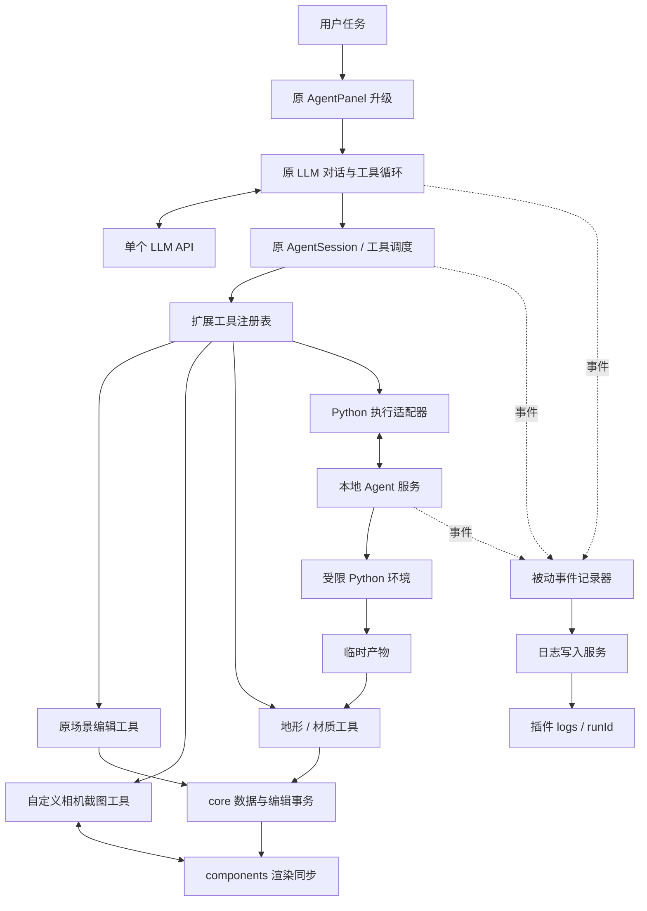

# LLM 插件升级：功能清单与整体架构设计

日期：2026-10-28  
状态：设计稿，尚未实现。本文中的新工具名、目录、数据结构和接口均为拟定契约。  
基础：当前 `src/modules/agent/` 中的老 LLM 插件及 3D-Layout 核心编辑、数据和渲染能力。

## 1. 设计主旨

本次工作是对老 LLM 插件的增量升级。实验目标是：给 LLM 一个包含场景编辑、观察、生成和代码执行工具的 Agent 环境，观察它为了完成用户的场景编辑任务，会主动选择哪些工具，以什么顺序调用，以及如何根据工具结果继续行动。

插件提供能力和执行环境；LLM 决定行动。插件自动记录实际发生的事情，供事后实验分析使用。

明确不参考、不依赖、不迁移 CoAgent 的架构或实现；不增加规划器、评判器、多 Agent 协作、分区调度或固定工作流。

### 1.1 本次升级范围

1. 自定义镜头截图：允许 LLM 自行指定观察相机和截图参数。
2. 地形生成：支持参数化生成，以及导入 Python 生成的高度场。
3. 材质生成：支持 PBR 材质创建、程序化纹理生成与应用。
4. 自定义 Python：执行 LLM 编写的代码，返回计算结果及生成文件。
5. 自动动作记录：Agent 宿主记录模型请求、返回、工具调用、执行结果及场景修改状态，保存到插件的 `logs` 文件夹。
6. 必要 UI 优化：更好地输入任务、阅读工具过程、查看截图、代码、产物与日志状态。

### 1.2 不属于本次升级的内容

- 新建另一套 Agent 插件替代老插件。
- 强制执行“读取 → 截图 → 规划 → 编辑 → 检查”的流程。
- 自动插入截图、地形生成、材质生成等工具调用，伪装成 LLM 的选择。
- 由第二个模型自动评判、纠错或替 LLM 选择下一步。
- 会话管理平台、复杂资产管理平台、节点图编辑器。
- 第一版支持任意 Shader、洞穴地形或任意系统命令。
- 日志自动反向驱动模型决策。

### 1.3 实验设计原则

| 原则 | 具体要求 |
|---|---|
| 自主选择 | 工具描述说明用途、参数、返回值和边界，不规定完成任务的推荐顺序 |
| 真实记录 | 原始事实由程序采集；模型自述另行标记 |
| 可区分来源 | LLM、用户、宿主自动行为分别记录 |
| 不隐藏干预 | 自动保存、回滚、校验、取消、裁决等均有记录 |
| 可比较 | 保存模型配置、提示词、工具 schema、初始场景和执行环境版本 |
| 可恢复 | 场景写入沿用统一编辑事务，失败不会绕过历史系统 |
| 范围克制 | 只增加实验所需的工具和必要的宿主支持 |

工具参数校验、输出校验是确定性的宿主检查，用于维护输入输出契约，不是任务质量评判。例如可以拒绝含 NaN 的高度图，不能由宿主擅自判定“山丘不够美观”并重写它。

## 2. 老插件基线与改动边界

以下基线来自本次查阅的工作区代码，工作区含已有未提交修改，不等同于某个固定发布版本。正式实验应另外保存实际代码版本与差异标识。

### 2.1 保留的能力

| 能力 | 当前实现入口 | 升级处理 |
|---|---|---|
| 流式对话、模型请求与工具循环 | `llmChatTransport.ts`、`llmClient.ts` | 保留，补充运行上下文、取消信号和记录钩子 |
| API 档案与设置 | `llmSettings.ts`、`LlmSettingsModal.tsx` | 保留，不重构为模型路由系统 |
| 工具注册与执行 | `tools.ts` | 保留入口，按领域拆分工具实现 |
| 入站协议与事务处理 | `protocol.ts`、`session.ts` | 保留，扩展新工具、运行标识和取消语义 |
| 场景读取 | `scene.get_state` | 扩展地形、材质和生成资源摘要 |
| 对象编辑 | `asset.add/remove/set_transform/adjust_transform` | 保留语义；支持地形对象时明确适用范围 |
| 截图与拾取 | `viewport.screenshot/pick` | 兼容旧截图调用，新增相机和截图标识 |
| 调用记录 | `recorder.ts` | 从内存摘要升级为运行事件记录 |
| 日志导出 | `log.list/write` | 保留兼容用途，不作为实验自动记录的前提 |
| 提案与自动编辑 | `session.ts` | 保留，不重定义成复杂工作流 |
| 编辑历史、场景保存 | `core/edit`、`core/io` | 扩展新数据类型的支持 |

### 2.2 已有能力不重复建设

老插件已有截图、工具调用计数、内存调用记录、日志导出和单轮循环上限。新设计分别补足自定义视角、完整执行事件、持续落盘和可见的运行状态，而非将它们作为从零新增的功能。

原始日志工具可供兼容使用，但默认实验工具清单不向 LLM 暴露 `log.list/write`：记录应由宿主自动完成，不消耗模型主动选择工具的步骤。工具是否暴露必须写入实验配置。若要进行严格的新旧对照，应保持两组共有工具的暴露方式一致，或将差异列为实验变量。

## 3. 角色、标识与运行语义

### 3.1 角色分工

| 角色 | 职责 |
|---|---|
| 用户 | 给出任务，可查看过程、停止执行、接受或撤回预览 |
| LLM | 返回文字和工具请求，决定工具、参数、顺序与结束时机 |
| Agent 宿主 | 发送请求、执行工具、维护事务、返回结果、自动记录 |
| Python 执行环境 | 在限定环境中运行代码，产生结构化结果和文件 |
| 3D-Layout 核心 | 持有场景事实数据、维护历史、同步渲染与保存 |

### 3.2 标识

- `conversationId`：当前对话标识，不要求第一版建设历史会话 UI。
- `runId`：一次用户提交触发的运行；包含多次模型请求和工具调用。
- `requestId`：一次模型请求。
- `callId`：宿主生成的工具调用标识；另外保留厂商返回的工具调用 ID。
- `txId`：现有编辑事务标识。一轮运行可包含多个事务。
- `sceneRevision`：内存场景修改版本；不要用磁盘保存次数替代。
- `screenshotId`：一张截图及其拍摄状态。
- `artifactId`：一个经过登记的生成产物。

所有异步结果都携带 `runId` 和场景身份，防止取消后或切换场景后将迟到结果应用到错误场景。

### 3.3 默认运行方式

继续使用现有单 LLM 工具循环。模型返回工具调用时由宿主执行，结果回传模型；没有工具调用时，该轮自然结束。自然结束只表示模型结束响应，不表示任务被独立验证成功。

保留现有提案模式和自动编辑模式。实验建议采用自动编辑模式以减少人工裁决的影响，但这只是运行配置建议，不改变默认用户权限偏好。若采用提案模式，应记录每次接受、拒绝与用户后续输入。

现有按工具批次形成事务的行为在本次升级中保留；不要悄悄改成整轮唯一事务。取消时只回滚当前未提交事务，已经提交的事务仍然保留并在运行摘要中列出。

## 4. 详细功能清单

### 4.1 自定义镜头截图

**功能目标**：LLM 能自由指定从哪里、朝哪里、以什么投影和分辨率观察场景。

必需功能：

- 保留无参数截取当前视口的行为。
- 支持透视相机和正交相机。
- 支持位置、目标点、向上方向、裁剪范围和投影参数。
- 支持指定输出宽高，并限制最大像素数。
- 隐藏编辑器辅助线、选中轮廓和 gizmo，保持与旧截图口径一致。
- 返回图片、相机状态、图像尺寸、场景版本与截图 ID。
- 将实际发送给模型的图片单独关联记录；不能仅凭 UI 显示图片认定模型看过图片。
- 截图与自定义相机默认不改变用户主视口，也不写入场景编辑历史。
- 等待请求时已经涉及的必要资源和渲染更新完成，超时返回明确错误。

设计选择：第一版以“截图参数内携带完整相机状态”实现自定义镜头，不增加长期相机工作区、预设观察计划或自动多视角巡检。每张图都能独立复现其拍摄参数。

`viewport.pick` 必须新增 `screenshotId` 参数。拾取使用对应截图的相机和尺寸；若场景版本已经改变，返回 `STALE_OBSERVATION`，由 LLM 决定是否重新截图。第一版不保存可供旧版本射线拾取的整套历史渲染场景。

模型关闭图像输入时，返回的工具结果应明确 `imageDelivered: false`。截图仍可以保存供实验分析，但不能把尺寸信息当成视觉观察结果。

### 4.2 地形生成

**功能目标**：LLM 根据任务自行决定是否生成地形、使用哪些参数，以及是否用 Python 定制算法。

第一版采用高度场地形，覆盖平地、丘陵、山谷等单值高度表面。

必需功能：

- 参数化创建：宽度、深度、网格采样数、高度幅度、噪声尺度、种子。
- 导入 Python 生成的高度场产物。
- 更新已有地形的高度数据、变换和材质。
- 查询指定世界坐标下的地形高度及必要的法线信息。
- 删除地形。
- 保存后重新打开、接受/拒绝、撤销/重做。

第一版不包括洞穴、悬挑、多层地表、侵蚀编辑器、道路雕刻和自动生态分区。

生成地形不会自动移动已有对象。LLM 可以调用高度查询并自行调整对象位置；宿主不能隐式替它完成贴地布局，否则会影响对工具选择的观察。

高度场约定：米单位，+Y 向上；网格沿 X/Z 展开；`heights[z * samplesX + x]` 为对应顶点的局部 Y 高度；地形中心位于局部 X/Z 原点。尺寸指边界间跨度，采样数均至少为 2。

### 4.3 材质生成

**功能目标**：LLM 自行创建材质、配置参数和纹理，并选择应用对象。

第一版“生成材质”具体指：创建可保存的 PBR 材质描述，以及通过 Python 生成可供该材质引用的纹理。它不依赖额外的文生图服务。

必需功能：

- 创建 PBR 材质：基础颜色、金属度、粗糙度。
- 可选颜色纹理、法线纹理、粗糙度纹理。
- 纹理重复、缩放等基础设置。
- 查询对象材质槽与当前绑定。
- 将材质应用到指定对象及指定材质槽。
- 更新材质参数、恢复原始材质绑定。
- 用 Python 产生纹理，再通过产物 ID 绑定。
- 参数和纹理引用可保存、撤销和重做。

明确区分“更新共享材质”和“为单个对象创建独立材质”。默认工具描述必须说明共享更新影响所有引用对象；工具结果返回实际受影响对象列表。

对于 GLB，使用宿主登记的稳定材质槽 ID；不依赖模型任意猜测 mesh 名称。对象被卸载和重新加载后，槽映射应保持稳定或明确报告失效。

第一版不开放任意 GLSL/Shader 执行。自定义 Shader 属于独立扩展，不与 PBR 参数和程序化纹理混为一谈。

### 4.4 自定义 Python 代码

**功能目标**：LLM 可以提交自定义 Python，完成计算、数据处理、地形高度场或纹理生成。

输入包括代码、JSON 参数、已登记的输入产物 ID 和可选的执行时间请求。执行时间请求只能收紧或在宿主上限内设置，不能由模型解除限制。

输出包括：

- `stdout`、`stderr`，附截断标记和原始输出文件引用。
- JSON 结果。
- 生成产物清单与元数据。
- 执行耗时、退出状态、环境版本。

代码可以使用规定目录内的文件接口和预装依赖，自由组织算法、循环和函数。不允许通过黑名单删关键字来声称完成安全隔离。

Python 第一版通过数据交换与场景交互：输入可含 LLM 传入的场景数据，输出由地形、材质工具消费。它不直接访问浏览器中的 three 对象，不直接修改 `scene.json`，也不隐式执行一串场景编辑命令。

保留两条路径以观察模型选择：LLM 可以直接调用参数化地形工具，也可以先写 Python 再导入高度场。插件不替它选择。

### 4.5 自动动作记录

**功能目标**：记录 LLM 在实验环境中的实际行为，不要求 LLM 调用日志工具，也不要求它额外解释每一步。

完整记录范围：

1. 用户输入及本次运行配置。
2. 模型实际收到的系统提示、消息与工具 schema；大对象可使用内容引用。
3. 模型返回的可见文字、工具调用原始名称与参数。
4. 工具请求到达、校验、执行开始、成功、失败、拒绝和取消。
5. 工具结果以及真正回传给模型的内容，两者可能因截断或图片设置不同。
6. Python 代码、依赖环境、运行输出及产物。
7. 场景修改、事务提交/回滚、保存结果。
8. 用户取消、人工裁决、场景切换、配置变更意图。
9. 运行结束原因。

不得将模型说明当成内部思维过程；只保存接口实际提供的可见内容，不推测模型未输出的推理。

### 4.6 UI 优化范围

只增加支撑上述能力所需的界面，不建设复杂任务管理系统。

- 多行输入，Enter 发送、Shift+Enter 换行；保留中文输入法组合输入保护。
- 模型运行时允许编辑草稿，发送仍受运行状态限制。
- 对话区使用可用空间，底部输入区保持可达。
- 用户向上阅读时不强制滚动到底部；显示“回到最新”。
- Markdown 和代码块渲染，代码复制；禁用未经处理的 HTML 注入。
- 工具调用显示为卡片：名称、状态、耗时、可展开参数和结果。
- Python 卡片显示代码、输出和错误；运行中显示可取消状态。
- 截图归属于对应调用，支持放大和查看相机参数。
- 地形/材质结果卡片显示产物、对象和基础参数；不自动为 LLM 截图。
- 显示日志状态：记录中、已落盘、写入失败，以及打开/导出记录入口。
- 将“变更前确认”改为“预览后确认”，保留原有接受/撤回模式。
- 区分“已应用”“保存中”“已保存”“保存失败”。
- 顶部模型与权限配置在运行期间锁定或明确标记下轮生效。

暂不加入参考图上传、对象 @ 引用、历史会话管理、任务模板推荐等独立功能。它们可后续讨论，不应在本次实验环境中无意增加输入条件或提示干预。

## 5. 工具接口设计

### 5.1 接口原则

保留规范工具名与厂商兼容工具名之间的现有映射。工具 schema、UI 权限说明和调度策略从同一注册表派生，避免不同位置的清单不一致。

工具描述应中性，不使用“每次编辑前必须截图”“完成后必须验证”等策略指令。工具必要的输入依赖可以说明，例如纹理绑定必须引用有效产物 ID。

### 5.2 工具清单

| 工具 | 类型 | 主要参数 | 主要结果 |
|---|---|---|---|
| `scene.get_state` | 保留/扩展，读 | 原有参数 | 资产、地形、材质引用和版本 |
| `viewport.screenshot` | 扩展，读 | 可选 camera、width、height；兼容 maxWidth | screenshotId、图片、相机、版本 |
| `viewport.pick` | 扩展，读 | screenshotId、x、y | 对象 ID、世界命中点；或过期错误 |
| `asset.add` | 保留，写 | 原有模型引用与变换 | 对象 ID |
| `asset.remove` | 保留/扩展，写 | 对象 ID | 删除结果，含地形对象支持 |
| `asset.set_transform` | 保留/扩展，写 | 对象 ID、绝对变换 | 最终变换 |
| `asset.adjust_transform` | 保留/扩展，写 | 对象 ID、增量 | 最终变换 |
| `terrain.generate` | 新增，写 | 尺寸、采样数、幅度、尺度、种子、可选材质 | 地形对象 ID、边界、生成参数 |
| `terrain.apply_heightfield` | 新增，写 | artifactId、可选 terrainId、变换 | 创建/更新后的地形对象 ID |
| `terrain.sample` | 新增，读 | terrainId、世界 X/Z 点数组 | 高度、法线、越界标记 |
| `material.get` | 新增，读 | 对象 ID 或 materialId | 材质槽、绑定和参数 |
| `material.create` | 新增，写 | PBR 参数、纹理产物引用 | materialId |
| `material.update` | 新增，写 | materialId、参数 patch | 更新结果、受影响对象 |
| `material.apply` | 新增，写 | materialId、对象/材质槽列表 | 绑定结果 |
| `material.reset` | 新增，写 | 对象/材质槽列表 | 恢复原始绑定结果 |
| `python.execute` | 新增，生成 | code、inputs、inputArtifactIds、timeoutMs | result、输出、产物列表 |

新增 `generate` 权限类型，用于表示会生成临时文件但不直接修改场景的操作。它不同于只读，也不同于可撤销的场景写入。修改 `AgentAccess` 时须同步更新 UI、调用计数、权限说明和协议。

默认实验清单排除兼容日志工具。第一版不单独增加相机状态修改工具：自定义相机随截图请求传入，减少隐式状态。

### 5.3 截图请求示例

```json
{
  "camera": {
    "projection": "perspective",
    "position": [12, 9, 12],
    "target": [0, 0, 0],
    "up": [0, 1, 0],
    "fovDeg": 50,
    "near": 0.1,
    "far": 300
  },
  "width": 1024,
  "height": 768
}
```

正交相机使用 `viewHeight` 指定垂直世界跨度，横向跨度由宽高比决定；不同时接受相互矛盾的视场角和正交跨度。位置与目标相同、向上向量退化、裁剪面错误等输入返回参数错误。

### 5.4 高度场产物格式示例

```json
{
  "schemaVersion": 1,
  "kind": "heightfield",
  "width": 40,
  "depth": 30,
  "samplesX": 3,
  "samplesZ": 2,
  "heights": [0, 1, 0, 0, 0.5, 0]
}
```

高度数量必须等于采样数乘积，所有数值有限，并满足配置的尺寸、采样和高度上限。示例仅用于说明格式，不代表推荐生成参数。

### 5.5 统一结果与错误

保留现有 `ok/data/error` 风格，同时逐步增加机器可读的错误码和元数据。旧工具返回值需要适配，不应直接假设现有字符串错误已经是结构化对象。

```ts
type ToolResult =
  | { ok: true; data: unknown; meta: ToolMeta }
  | { ok: false; error: { code: string; message: string; details?: unknown }; meta: ToolMeta }

interface ToolMeta {
  runId: string
  callId: string
  elapsedMs: number
  sceneRevisionBefore: number
  sceneRevisionAfter: number
  artifactIds?: string[]
}
```

错误码至少包括 `INVALID_ARGUMENTS`、`NOT_FOUND`、`OUT_OF_SCOPE`、`STALE_OBSERVATION`、`RESOURCE_LIMIT`、`TIMEOUT`、`CANCELLED`、`EXECUTION_FAILED`、`UNSUPPORTED_CAPABILITY`。

错误是否重试由 LLM 决定。第一版不自动重试模型决策或场景写工具；必要的网络传输重送必须有请求去重，并在日志中说明。

## 6. 整体架构

### 6.1 架构图



图中的箭头是数据流与调用关系，不是强制的任务阶段顺序。LLM 可以仅使用原有工具完成任务，也可以组合新工具。

### 6.2 分层职责

| 层 | 责任 | 不承担的责任 |
|---|---|---|
| UI | 输入、状态和结果展示 | 替模型选择工具 |
| 对话循环 | 模型协议、消息历史、工具结果回传 | 自动规划、自动验收任务 |
| Session | 调用关联、事务、取消、场景一致性 | 判断场景是否符合用户审美 |
| 工具层 | 单项能力与确定性参数校验 | 隐藏执行其他模型工具 |
| Core | 场景事实数据、历史与保存 | Python 进程管理 |
| 渲染层 | 数据同步、截图、拾取 | 持久化业务状态 |
| 本地服务 | Python、文件与产物、日志写入 | 调用另一个 LLM 决策 |
| 记录器 | 接收事件、关联、写盘 | 反向改变工具选择 |

### 6.3 拟定目录

```text
src/modules/agent/
  AgentPanel.tsx
  agentStore.ts
  llmChatTransport.ts
  llmClient.ts
  llmSettings.ts
  LlmSettingsModal.tsx
  session.ts
  protocol.ts
  tools.ts                       # 保留注册与调用入口
  tools/
    sceneTools.ts                # 现有工具逐步移入
    viewportTools.ts
    terrainTools.ts
    materialTools.ts
    pythonTools.ts
  runtime/
    runContext.ts                # 标识、冻结配置、取消信号
    artifactClient.ts
  recorder.ts                    # 事件入口，兼容旧调用点
  logging/
    events.ts
    writer.ts
    summary.ts
  ui/
    ToolCallCard.tsx
    ScreenshotCard.tsx
    PythonResultCard.tsx
    ArtifactCard.tsx
  server/
    routes.ts
    pythonRunner.ts
    artifactStore.ts
    logStore.ts
    python/                      # Python 启动与输出约定
  logs/                          # 自动运行记录，生成目录
  .runtime/                      # 临时工作目录，生成目录

src/components/
  ...                            # 截图桥接、地形与材质同步
src/core/
  ...                            # 扩展类型、编辑操作、IO
assets/generated/                # 正式生成资源
```

这是职责划分，不要求一次性搬迁所有旧代码。日志和临时目录应在实施时加入忽略规则，不能混入源码提交。正式资产按项目资产管理策略处理。

默认日志目录明确为仓库中的 `src/modules/agent/logs/`，因为当前插件实际位于该目录；不另建 `plugins/llm` 复制实现。部署时允许宿主配置可写数据根目录，该实际路径写入运行元数据。

## 7. 宿主服务与 Python 执行

### 7.1 服务接入

沿用当前本地开发/预览服务的接口接入方式，但新逻辑放入 Agent 自身的 server 模块，避免将全部实现堆进 Vite 配置。

拟定接口：

| 接口 | 用途 |
|---|---|
| `GET /api/agent/capabilities` | 检查 Python、日志写入、产物服务是否可用 |
| `POST /api/agent/runs` | 建立运行记录和工作目录 |
| `POST /api/agent/runs/:id/events` | 批量追加事件，按事件 ID 去重 |
| `POST /api/agent/runs/:id/finish` | 写入结束信息并刷新记录 |
| `POST /api/agent/python/jobs` | 创建执行作业，返回 jobId |
| `GET /api/agent/python/jobs/:id` | 获取状态和输出 |
| `POST /api/agent/python/jobs/:id/cancel` | 取消作业 |
| `GET /api/agent/artifacts/:id` | 读取登记产物 |
| `POST /api/agent/artifacts/:id/promote` | 校验并转为正式资源 |

`python.execute` 对 LLM 仍是一次等待最终结果的工具调用；内部可以使用作业轮询和取消接口。轮询属于宿主机制，不记为模型主动调用。

浏览器不能任意写入本地目录，也不能原生运行本地 Python。纯静态托管时必须明确禁用不可用工具并提示实验环境不完整；完整实验启动前检查服务可用性，不允许运行中悄悄换成不同执行环境。

### 7.2 隔离边界

Python 执行应使用独立受限环境：只挂载本次运行所需的只读输入和可写输出，默认无网络，不传入 API Key 等宿主环境变量，限制进程、内存、时间和输出。

单独创建子进程、清理环境变量、扫描代码均不能单独构成沙箱。实现时采用具备文件和网络隔离能力的执行后端，例如本地容器后端；具体依赖版本在实现阶段验证并固定。

如果执行后端不可用，则明确返回能力不可用，不自动退回宿主机任意 Python 执行。取消必须终止整个作业及其子进程，不能只关闭 HTTP 请求。

本地接口限定可信来源与会话授权，校验所有运行和产物 ID；路径由宿主生成，不接受模型提供任意绝对路径。产物登记拒绝越界路径、符号链接逃逸和超限文件。

### 7.3 初始资源限制建议

以下为待基准测试调整的起始值，不是已验证的性能承诺：

- 同时最多 1 个活跃运行、1 个 Python 作业。
- 单次 Python 默认 30 秒，宿主最大 120 秒。
- Python 内存上限 512 MiB。
- 单次产物总量上限 64 MiB，标准输出/UI 展示单独限长。
- 截图单边最大 2048 像素，总像素不超过 2048 × 2048。
- 高度场每轴采样数最大 257。
- 保留当前最多 24 轮模型工具循环的限制，记录实际配置。

所有上限在运行开始时固定并写入配置，不按模型表现动态改变。达到限制时返回明确信息，不能静默截断高度数据或改变网格分辨率。

## 8. 场景数据与资源生命周期

### 8.1 数据扩展

为保持旧场景兼容，新增字段采用可选字段或可区分的新对象类型，旧资产的 `ref/transform` 保持原义。

建议的数据关系：

- 地形对象仍拥有稳定对象 ID 和变换，附带 `kind: 'terrain'` 与高度场资源引用。
- 普通模型对象维持原有 `ref`，通过可选的材质槽覆盖映射引用材质。
- 场景维护可选材质字典，以 materialId 为键。
- 正式高度场和纹理以稳定资源引用保存，不把服务临时 artifactId 当成持久引用。
- 场景格式新增明确的 schema 版本，区别于现有 `meta.version` 的保存版本含义。

这是逻辑模型，具体 TypeScript 联合类型在实现时需要检查现有 `assets` 遍历、模型目录查询、选中、边界计算与历史操作，避免加入地形后把所有对象仍视为 GLB。

### 8.2 产物状态

```text
Python/参数生成输出
  → 临时产物登记
  → 类型与资源校验
  → 正式内容存储（稳定引用）
  → 编辑事务中的预览引用
  → 提交后成为场景引用
```

大文件不复制到每条撤销记录。事务保存引用的前后变化，资源存储保持不可变；更新内容生成新版本引用。

拒绝提案后移除场景引用，但不能立即删除仍被日志、当前场景、历史撤销或重做引用的资源。清理采用引用检查或保留期，不在事务回滚时盲目删文件。

清理日志不得影响正式场景资产；清理临时资源不得破坏已提交结果。失败的生成也应保留必要的代码与错误记录。

## 9. 自动日志的数据设计

### 9.1 文件布局

```text
logs/<runId>/
  run.json                       # 配置、标识、状态及内容索引
  events.jsonl                   # 追加式结构化事件
  summary.md                     # 程序生成的可读摘要
  scene-before.json              # 初始内存场景，不是可能过期的磁盘文件
  scene-after.json               # 正常结束时的最终内存场景
  messages/                      # 实际模型请求/响应及工具回传引用
  screenshots/                   # 实际生成的截图
  scripts/                       # 实际提交的 Python
  outputs/                       # 输出文本、错误、生成产物证据
```

日志按运行组织。清空对话、切换场景和关闭插件不能删除已落盘记录。浏览器或进程异常退出可能没有 `scene-after.json`，此时状态标记为 `interrupted`，保留最后已持久化事件。

### 9.2 事件结构

```ts
interface RunEvent {
  schemaVersion: 1
  eventId: string
  runId: string
  seq: number
  occurredAt: string              // UTC ISO 时间
  receivedAt?: string             // 服务接收时间
  source: 'llm' | 'host' | 'user' | 'python'
  type: string
  requestId?: string
  callId?: string
  txId?: string
  parentEventId?: string
  sceneRevision?: number
  payload: Record<string, unknown>
}
```

单个日志写入服务分配持久化序号并按 eventId 去重；前端和 Python 的本地时间只作发生时间。使用父事件与调用 ID 表达因果关系，不依赖不同进程的时钟严格同步。耗时在相应进程内部使用单调时钟测量。

### 9.3 核心事件类型

| 类别 | 事件示例 |
|---|---|
| 运行 | run.started、run.completed、run.cancelled、run.interrupted、run.limit_reached |
| 模型 | model.requested、model.responded、model.failed |
| 工具 | tool.requested、tool.rejected、tool.started、tool.succeeded、tool.failed、tool.cancelled |
| 回传 | tool.result_delivered、image.delivered |
| 编辑 | transaction.started、committed、rolled_back |
| 保存 | scene.save_started、scene.saved、scene.save_failed |
| Python | python.started、python.exited、python.terminated |
| 产物 | artifact.created、validated、promoted、rejected |
| 人工 | user.accepted、user.rejected、user.cancelled |
| 记录 | log.flush_failed、log.recovered |

工具请求必须在白名单与参数校验前记录，保证未知工具、非法参数、事务外写入也能被统计。工具返回失败属于正常可观察结果，不可以从统计中删除。

每个已经开始的调用最终具有成功、失败、取消或中断之一；插件崩溃恢复后可将没有结束事件的调用标记为中断，不能推测其成功。

### 9.4 运行配置快照

至少保存：

- 用户任务原文、对话历史是否为空。
- 系统提示全文及 hash。
- 工具名称、完整 schema、排列顺序及 hash。
- 模型标识、协议、去凭据的服务地址、实际发送的生成参数。
- 图像发送开关、图片缩放与历史图片保留策略。
- 权限模式、循环上限、Python 和生成资源限制。
- 初始场景快照、模型目录版本、资源内容 hash 或清单。
- 代码版本、未提交差异指纹、Python 环境和依赖版本。
- 随机种子：区分由模型传入、宿主生成或未知。

API Key、Authorization、带凭据 URL 和进程环境敏感值不写入日志。对其他可能含凭据的内容做脱敏，并记录发生脱敏，不声称保存了未改变的原始字节。

### 9.5 记录故障与实验有效性

开始实验前若无法创建日志，拒绝开始并提示修复。运行过程中写入失败，保留有界内存缓冲并提示，不因记录失败悄悄改变 LLM 的决策流程；最终将该次运行标记为 `logIncomplete`，不得作为完整轨迹使用。

正常结束时等待日志刷新完成，再显示“记录已保存”。文件采用追加写入、事件去重和明确结束标志；批量写入减少开销，但异常退出仍可能损失尚未持久化事件，文档与 UI 不承诺零丢失。

### 9.6 可从日志直接得到的实验指标

- 主动调用的工具种类、次数、顺序。
- 是否截图、截图角度与调用位置。
- 是否使用 Python，以及生成代码与执行次数。
- 参数化生成与 Python 生成路径的选择。
- 错误后是否调整参数、切换工具或再次观察。
- 是否在修改后主动截图。
- 成功、失败、拒绝、取消的调用数量。
- 模型请求耗时、工具耗时、总耗时。
- 供应商实际返回的 token 使用量；缺失时记录未知，不猜测。
- 最终提交与回滚的修改数量。

以上是行为指标，不直接等同于任务完成质量。质量评价可由实验者在运行结束后独立进行，不回流到本次插件控制流程。

## 10. UI 结构与状态

建议保留单面板，不增加多页任务系统：

```text
LLM 场景编辑                      设置
模型档案 ▾                 预览后确认 / 自动编辑

对话与执行过程
  用户消息
  模型回复
  工具卡片（默认折叠参数）
  截图 / Python / 地形 / 材质结果

当前提案：修改摘要       接受修改 / 撤回修改
当前状态：执行 Python · 已用 8 秒
日志：记录中 / 已保存 / 写入失败

多行输入框
                                  发送 / 取消运行
```

状态以实际事件驱动：空闲、请求模型、执行工具、等待裁决、取消中、已结束。工具内部可以显示“运行 Python”“加载纹理”等具体状态，但不显示并不存在的规划阶段或虚假的百分比。

工具卡片与实验日志共享调用 ID。UI 可以截断长输出，但必须提供完整记录入口，并显示截断标记。小屏侧栏内以摘要为主，长代码、截图在详情浮层查看。

修正设置相关的必要问题：进入设置定位当前档案；区分本地传输已启动与 API 测试成功；更换服务地址时避免无提示沿用不匹配的凭据。运行期间冻结实际配置，修改只影响下一轮。

## 11. 提示词与实验变量控制

### 11.1 提示词允许包含

- 场景单位和坐标系。
- 工具用途及参数契约。
- 可访问资源和执行边界。
- 工具失败返回值的解释。
- 现有提案/自动编辑机制的必要说明。

### 11.2 提示词不默认包含

- 每次任务必须先读场景或截图。
- 必须使用新增工具。
- 必须执行 Python。
- 必须按指定步骤规划与验收。
- 必须解释或补写每一步日志。

默认不附带一套强引导的示范任务。如果实验需要 few-shot 示例，必须作为显式实验条件保存。

### 11.3 新旧插件对照

实验者应控制初始场景、任务、模型、生成参数、权限模式和历史上下文；记录工具集与描述的变化。新增工具数量、描述长度和顺序本身可能影响模型选择，应保留而不是隐藏这些差异。

实验开始前由外部流程恢复初始场景，不由 Agent 在运行中自动重置。重跑可复现输入和环境，但不能保证远程模型输出或 GPU 渲染逐字节相同。

## 12. 兼容、取消与失败处理

- 旧场景无需新增地形或材质字段也应正常加载。
- 旧 `viewport.screenshot` 无自定义相机参数时保持原行为。
- 旧拾取调用可在兼容模式保留当前视口语义；默认实验 schema 使用截图 ID，避免含糊行为。两种模式写入协议版本。
- 新增权限、错误和工具字段时更新协议版本，对 WebSocket/回环传输保留明确兼容策略。
- 一轮运行使用同一个取消上下文，模型请求、排队调用、Python 和资源加载都检查该状态。
- 取消后不开始新工具，迟到结果仅记录，不能应用。
- 取消不能回滚已完成的外部计算事实或已经提交的历史；日志说明保留了哪些结果。
- 人工切换场景导致旧运行停止，旧结果不得写入新场景。
- 任一工具内部产生部分场景写入后失败，需回滚该工具的局部修改或整个当前事务，并如实记录；不能返回失败却留下未说明的半成品修改。
- 资源载入和保存异常必须在 UI 与日志中分别呈现，不将“数据提交成功”误报为“渲染和磁盘保存成功”。

## 13. 实施顺序

实施顺序是开发安排，不是 LLM 在实验中必须遵循的执行顺序。

| 阶段 | 工作内容 | 交付结果 |
|---|---|---|
| A | 固定老插件基线，增加 runId、取消上下文和统一记录入口 | 原工具行为可完整追踪 |
| B | 本地日志服务、配置快照、事件与摘要落盘 | 每轮生成独立日志目录 |
| C | 自定义相机截图与截图绑定拾取 | 模型可自由指定观察视角 |
| D | 地形与材质数据、编辑、渲染和保存 | 新内容可生成、预览、撤销、重开 |
| E | Python 服务、执行环境和产物协议 | 模型代码可生成数据供工具消费 |
| F | 工具卡片、代码/图片详情、多行输入、状态反馈 | 界面足以观察真实运行 |
| G | 完整实验验收、冻结环境与工具清单 | 可进行新旧工具环境对比 |

每阶段均为原插件增量修改。除必要的核心类型和渲染支持外，不调整其他插件架构。

## 14. 验收标准

### 14.1 自主性

- 对仅需移动对象的任务，LLM 可以只调用旧工具并结束。
- 不调用截图、Python、地形或材质工具时，宿主不会替它调用。
- 工具错误回传后，下一步由模型决定。
- 日志功能无须出现在模型工具选择中也能完整运行。
- 模型可见内容与宿主内部处理有清晰记录边界。

### 14.2 截图与生成

- 不同自定义相机参数能产生对应构图，且主视口默认不跳动。
- 截图绑定拾取准确；旧版本截图返回明确过期错误。
- 参数化地形和 Python 高度场都可保存、撤销和重新加载。
- Python 生成纹理可应用于指定对象，不意外覆盖其他对象的独立材质。
- 相同种子和相同生成算法版本产生可比较的地形数据。

### 14.3 运行与资源

- Python 超时、错误和取消有明确结束状态。
- 停止后没有迟到修改落入场景。
- 接受、拒绝、自动提交及保存失败有不同事件。
- 清理日志不破坏正式场景，撤销/重做不引用已删除资源。
- 隔离环境无法读取未授权宿主文件或继承模型凭据。

### 14.4 日志

- 从事件可还原所有模型请求、工具调用顺序、参数和结果。
- 未知工具与非法参数也有记录。
- UI 截断不导致原始记录无标记丢失。
- 能区分生成截图、将截图发送给模型，以及模型是否再次调用工具。
- 正常结束日志有完整结束标志；异常结束不被误判为成功。
- 日志中无 API Key 等已知凭据。

### 14.5 UI 与回归

- 老工具、原模型设置、提案与自动编辑仍然可用。
- 流式输出不会强制打断用户阅读历史。
- 工具卡片可以查看参数、结果、错误和耗时。
- 多行输入与中文输入法工作正常。
- 保存反馈与日志落盘反馈反映真实完成状态。

实现时优先测试事务回滚、截图状态绑定、取消、产物生命周期和记录完整性；UI 微调采用实际交互检查，不为纯样式变化编写重复实现的测试。

## 15. 设计结论

本次升级最终交付的是原 LLM 插件的扩展工具环境：LLM 可以自定义镜头截图、生成地形和材质、执行自定义 Python；Agent 宿主负责可靠执行和自动记录；UI 负责呈现真实过程。

插件不规定模型必须如何完成任务。实验要观察的正是：在这些能力可用时，LLM 自己会如何使用它们。
