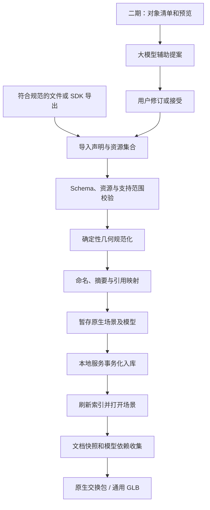

# Three.js 双向导入导出插件架构设计

日期：2026-10-18  
版本：v3，插件自包含、最小宿主接入  
状态：待实现的架构设计；本文中的服务、SDK 和接口均为拟新增能力。

## 1. 目标与架构决策

将外部 Three.js 场景转换成 **3D-Layout 原生场景及全局模型库资产**。模型文件随场景一起入库，场景加载方式、模型引用方式和现有数据格式保持一致。

最终数据落点：

```text
G:/GraduateDesign/Softwares/3D-Layout/
├─ scenes/
│  ├─ index.json
│  └─ demo-forest/
│     ├─ scene.json
│     ├─ threejs/view.json
│     └─ import-report.json
└─ assets/
   ├─ models/
   │  ├─ manifest.json
   │  └─ demo-forest-pine-tree/
   │     ├─ meta.json
   │     ├─ model.glb
   │     └─ import-integrity.json
   └─ hdri/
```

场景中的实例通过 `ref: "models/demo-forest-pine-tree"` 引用模型。导入后刷新索引并打开新场景，由现有通用渲染器显示。外部 Three.js 源码不作为一个独立页面嵌入执行；`threejs/view.json` 仍是视图绑定，不是源应用代码副本。

ZIP 仅用于交付文件，不要求引入场景私有模型目录。模型语义名称保留在目录 ID 和 `meta.json` 中。

采用两期方案：

| 项目 | 一期：规范驱动，无大模型 | 二期：大模型辅助准备输入 |
|---|---|---|
| 目标 | 完整规范输入可以自动转换、入库、打开和导出 | 减少旧场景补齐规范的人工工作 |
| 资产边界 | 来源方明确声明 | 优先沿用声明，可建议已有节点的分组，需审核 |
| 名称、分类、标签 | 来源方提供 | 可生成候选值，用户接受后固定 |
| 单位、尺寸、几何 | 显式单位 + 程序计算 | 同一期；不能以模型猜测替代测量 |
| 核心输出 | 原生场景、全局模型、索引 | 与一期完全相同 |
| 是否依赖模型服务 | 不依赖，支持离线处理 | 可选；服务失败不影响一期入口 |

二期是一期之前的“声明准备助手”，不另建一套导入引擎，也不意味着可以可靠自动识别任意场景中的物体。

## 2. 插件边界与最小接入

**把原生磁盘格式当作集成接口，把转换、校验、入库和辅助能力封装在插件内。** 不为导入插件重构宿主核心，也不把宿主已有问题列为插件前置改造。

推荐第一版部署为独立本地插件工具：插件自己的浏览器界面 + Node 服务 + CLI，显式配置工程根目录及 3D-Layout 页面地址。可以完全不改现有应用。若需要在左侧栏展示入口，只在 `src/App.tsx` 添加一个薄面板/按钮，打开插件界面；不引入通用插件框架。

| 宿主部分 | 处理方式 |
|---|---|
| `core/types.ts` | 不改。插件通过类型适配或版本化 schema 校验已有格式 |
| `core/store.ts`、`loader.ts` | 不改。入库后重新打开 `?scene=<id>`，沿用 boot 读取 manifest |
| `core/edit.ts`、commands | 不改。不合并当前场景、不增加历史操作、不注入文档 |
| `AssetInstance.tsx`、`ViewRig.tsx` | 不改。插件输出当前渲染器可消费的静态 GLB 和配置 |
| `modules/agent/*` | 不改。普通启动后读取原有全局 manifest |
| `core/io.ts`、`vite.config.ts` | 不改。文件写入由插件自己的本地服务负责 |
| `scripts/gen-manifest.mjs` | 不改。插件在受控安装阶段调用现有脚本并校验产物 |
| `App.tsx` | 独立工具模式零改动；内嵌入口模式仅增加入口装配 |

插件不调用 `useSceneStore.setState`，不 monkey-patch 加载器，不订阅或改写内部编辑历史。独立插件的 Three.js 适配器只操作它自己的对象树，不能触碰宿主 R3F 场景；原仓库 components 的分层规则继续约束宿主代码。

这一选择的明确代价：需要刷新/重新打开页面；默认导出磁盘上已保存的场景；不提供无刷新热更新、未保存内存状态导出或合并当前场景。这些可以以后通过宿主正式开放的接口增加，不是本插件一期或二期的前置需求。

## 3. 总体数据流



整条核心流水线不需要模型服务。二期输出只有结构化提案，经审核后转成与一期相同的输入契约。

## 4. 一期输入契约

完整字段约定以 [ThreeJS 场景导入规范](./ThreeJS场景导入规范.md) 为准，避免在两份文档维护不同 schema。实现时由一个 JSON Schema 同时驱动校验、SDK 类型和表单。

一期支持分两个实施步骤，但都不使用大模型：

- **一期 A**：`layout-import.json` + 每模型一个静态 GLB，完成原生入库与原生交换包导出。
- **一期 B**：外部 Three.js SDK、glTF 完整资源集合、通用 GLB 导出；基础形状拼装通过 SDK 输出同一契约。

任意 Three.js Object JSON 不纳入首个版本，后续增加经过版本约束的适配器。导入 JavaScript 源文件不等于得到场景；应由源应用在可信环境中运行后调用 SDK。

### 4.1 必需声明

来源方提供场景 ID/name、坐标单位、模型 key/name/category、模型源文件、实例 ID/modelKey/变换、相机和环境。未声明资产边界返回 `MISSING_ASSET_DECLARATION`，不默认拆分，也不猜测名称。

对 SDK：每个资产根必须显式绑定模型 key 和实例 ID；待保留的可渲染节点恰好属于一个根。重叠资产根和未覆盖节点阻断导出；明确排除的节点记录在报告。相机和环境走独立字段。

对文件：模型文件表示模型局部几何，实例变换作用在文件根之外。整间房屋若只声明一个模型，就只有一个整体布局资产；拆成家具的责任在来源方。

### 4.2 基础形状与重复实例

一张桌子的 BoxGeometry 桌面和四个 CylinderGeometry 桌腿可以保留在同一个模型 GLB 内，不需要合并成一个 Mesh。SDK 导出静态网格及受支持材质，不保留生成器代码或参数化编辑能力。

同一 modelKey 的实例必须有相同局部几何与材质定义，仅允许布局变换等已声明实例字段不同。几何或材质不同则声明不同 key；不可忽略差异强制复用。InstancedMesh 的实例矩阵、颜色等只有在适配器明确支持时转换，否则报错。

## 5. 一期确定性转换与模型一致性

### 5.1 资源解析

先建立上传目录的路径索引，再相对引用文件解析依赖，不依赖文件夹叫 models 还是 resources。GLB 也须检查是否存在外部依赖。模型、贴图、buffer、被引用 HDRI、隐藏实例资源全部收集。

源 SDK 将可读取的远程资源和临时 Blob 转成实际文件；导入服务不猜测缺失地址。优先生成自包含静态 GLB，并记录解码能力需求。一期默认输出不压缩 GLB，压缩输入仅在本地解码器已配置时接收。

### 5.2 坐标和原点

规范结果为米制、右手坐标系、Y 向上、底面中心原点，实例旋转为 XYZ 角度制。不能仅写 `meta.normalized` 就认为几何已经转换；该字段目前是记录而非运行时转换指令。

以列向量约定，源局部点为 p，源世界矩阵为 W，源世界到目标世界的变换为 C，源模型局部到规范局部的变换为 N：

```text
p_canonical = N × p
W_target = C × W × inverse(N)
W_target × p_canonical = C × W × p
```

计算实际几何边界，平移底面中心到原点，并补偿实例矩阵。SDK 抽离根布局变换，避免它同时保存在模型文件和实例记录里。相机位置、target 和环境中具有长度单位的值也同步转换。

将目标矩阵分解为 TRS 后必须重构验证。首个版本遇到剪切、负缩放和奇异矩阵明确拒绝；后续确定性烘焙适配器通过测试后才开放支持，不将复杂变换交给大模型计算。

### 5.3 静态化与材质

一期优先接收静态网格；蒙皮、morph、视频、GPU 位移等需来源方提前烘焙为受支持静态表示。自定义 ShaderMaterial 无法转换时拒绝。支持的材质参数、纹理颜色空间、UV、透明模式及纹理变换需建立兼容用例。

现有 normalizeGltf 会改变加载后的几何，导出不得直接把正在显示的副本视作原始资源。新输入在暂存阶段完成规范化；渲染与导出使用同一规范模型。旧资产保留兼容读取，迁移或导出时在独立副本中处理，不覆盖原文件。共享几何需要克隆后再烘焙，避免污染其他实例。

### 5.4 尺寸、边界和身份

`meta.dimensions` 从规范模型实际几何测得。当前 primitive sphere/cylinder 的真实生成方式不一定使用全部 dimensions 字段，因此插件的导出兼容适配器应复现当前版本的实际构建结果，并使用样例对照验证，不要求抽出或修改宿主构建器。

新增 `import-integrity.json` 记录：原文件摘要、规范模型及依赖摘要、模型定义摘要、转换器版本、转换选项、局部边界和来源映射。不要求改变当前 ModelMeta 的必需字段。

模型定义摘要包括影响几何/材质/规范化语义的内容，JSON 采用稳定序列化；名称、标签另行比较。字节相同证明内容一致；字节不同不自动认定视觉不同，但一期不做模糊复用。

插件的校验边界按局部包围盒八角经过实例矩阵变换后取 min/max。该结果是保守 AABB，不宣称是精确碰撞检测。现有 Agent 忽略旋转的边界估算问题仍存在，是宿主独立改进项，不通过插件修改其工具逻辑，也不将该估算作为导入验收真值。摘要不用于判断显示光照是否一致。

## 6. 命名、冲突与原生数据映射

默认模型目录 ID 为 `<scene.id>-<model.key>`，例如 `demo-forest-pine-tree`。这保留语义并减少跨场景重名；来源方负责 key 的含义，程序检查格式。复合路径长度另外校验，不直接截断造成冲突。

| 输入 | 原生输出 |
|---|---|
| scene.id/name | scene.json 的 meta.id/name，首次 version=1 |
| coordinates | 转换后 meta.unit='m'、meta.up='+Y' |
| model.key | 命名器生成模型目录 ID |
| model.name/category/tags | meta.json 对应字段 |
| 实际规范几何 | dimensions，source={type:'glb',file:'model.glb'} |
| instance.id/modelKey | SceneAsset.id 及解析后的 ref |
| instance.transform | 规范化并补偿后的 Transform |
| 相机/环境/可选视图 | SceneDocument.cameras/environment、ViewBinding |

规则：同一 ID 且规范定义、元数据一致时复用；冲突默认拒绝，预配置 `suffix-hash` 策略可追加摘要前缀并统一改写 ref，摘要前缀碰撞则延长。已有文件不原地覆写。不同名称即使同内容，一期也不强制跨 ID 合并，以免丢失语义。

场景 ID 冲突默认拒绝。同一输入、转换版本和选项的重复导入，仅在已保存结果的摘要仍与导入记录一致时视为无变化；已有场景后来被编辑过则不能错误地跳过冲突。

## 7. 入库事务与打开新场景

### 7.1 前端与本地服务分工

插件自己的前端/SDK 负责需要浏览器纹理解码的转换和预览；插件 application 层处理普通数据、引用与任务状态；独立 Node 本地服务负责受控文件写入、锁、索引和恢复。服务端独立复核 schema、文件摘要、引用及路径；GLB 元数据与边界可由共享纯数据检查器复核，不信任上传的 meta 声明。纯 Node 转换不能假设具备浏览器图片/Canvas API，应显式提供适配器，首版采用浏览器转换路径。

以下接口属于插件独立服务，不添加到宿主 Vite：

```text
POST   /api/interchange/prepare          上传文件集，生成暂存任务
GET    /api/interchange/jobs/:id         状态、报告、目标路径及冲突
POST   /api/interchange/jobs/:id/commit  按既定策略提交
DELETE /api/interchange/jobs/:id         取消未提交任务
```

服务只绑定回环地址，校验允许的 Origin 和会话令牌；独立插件 UI 与服务同源部署。接口接收受控 jobId，不允许客户端指定任意磁盘路径。静态托管无本地服务时，下载待安装的原生文件集；需要 CLI 安装或手动复制，不能宣称浏览器已经写入工程目录。

### 7.2 文件事务

```text
received → validating → staged → committing → committed
                    ↘ failed / cancelled
```

1. 插件在工程同卷暂存区生成全部文件，完成资源及几何校验，暂存目录放在 assets/models 和 scenes 扫描范围之外。
2. 获取插件安装锁，复核目标 ID 和摘要。安装期间不得并行启动另一导入、运行 gen-manifest 或手动修改目标目录；这是第一版的单写入者部署约束。
3. 在插件任务目录记录恢复日志及旧索引字节，明确本次新增路径和复用路径。
4. 发布新增模型、环境和新场景；调用原有 `src/scripts/gen-manifest.mjs`，核验两个索引包含新数据且引用完整。
5. 写提交完成标记，然后才提供打开链接。

保留原索引脚本意味着不能承诺多目录和两个索引的强原子可见性。安装期间不要刷新宿主或切换场景；已有内存场景可保持展示。第一版支持本地单写入者安装，不支持并发部署或其他读取端始终看不到中间状态的保证。

脚本失败时，插件移除本任务新增文件、恢复先前索引；不改复用模型。进程异常后，下次启动插件先恢复未完成任务，再允许新安装；恢复前不应重新运行宿主启动脚本。不能把插件私有锁描述成现有脚本也会遵守的全局锁。检测到外部改动时停止自动回滚并报告冲突，避免用旧索引覆盖新内容。

发布成功但客户端断线时，可查询同一 jobId。提交过程中取消进入受控恢复；不直接删除整个资产目录。更强的在线发布隔离属于后续独立基础设施需求，不为本插件修改核心服务。

路径检查包括绝对路径、盘符、路径穿越、符号链接、重复条目及大小写碰撞；对解压总大小、文件数、顶点和实例数设限。默认不执行输入代码或自动联网取缺失资源。

### 7.3 打开与历史边界

提交成功后提供宿主链接，例如 `http://localhost:5173/?scene=demo-forest`。默认在新标签页打开，让现有 boot 流程重新加载场景索引和 manifest，无需修改 store 或 App 的数据刷新逻辑。内嵌入口也使用同一方式，不主动刷新正在编辑的页面。

已打开的旧标签页保留原 manifest，不承诺看到刚加入的模型；需要重新加载才更新。新标签页不会丢失旧页面未保存内容，但同一场景多窗口写入仍沿用宿主现有限制。

文件入库成功与视口打开成功分别记录：加载失败时保留已提交文件并提供重试。插件关闭不影响已安装场景的读取。

一期和二期均不包含合并当前场景、自动保存未决提案或撤销文件安装。插件只创建新场景，现有 edit 历史保持原样。若将来需要内存导入，另提小型宿主 API 方案，而不是提前修改 edit。

## 8. 双向导出

### 8.1 原生交换包：完整往返入口

默认导出磁盘上已保存的场景。需要包含最近编辑时，用户先通过宿主现有保存功能落盘，再在插件导出；不读取正在运行的 store 或 Agent 提案状态。插件读取文档、view 和模型依赖，固定字节快照并复核读取前后的摘要；发现并发修改则重试或报告，不混合不同版本。静态宿主只能下载 scene.json 时，可由用户将该文件显式交给插件替代磁盘文档，并校验全部 ref。

包采用工程相对路径：

```text
forest.layout.zip
├─ package.json
├─ scenes/demo-forest/scene.json
├─ scenes/demo-forest/threejs/view.json
└─ assets/
   ├─ models/demo-forest-pine-tree/meta.json
   ├─ models/demo-forest-pine-tree/model.glb
   └─ hdri/...                         # 存在引用时携带
```

package.json 声明格式、schemaVersion、场景入口、逐文件大小和 SHA-256；清单排除自身以避免自引用。不要携带并覆盖接收工程的全量 manifest 或 scenes/index，由接收方按实际入库结果重建。

收集全部引用模型和场景/view 的环境依赖，包含隐藏资产。规范模型字节原样复制；现有 primitive 保留原生 meta/tint。原生包适配器从场景和 meta 构建等价内部导入计划，重新验证摘要、路径和冲突，复用一期发布流程。发生 ID 冲突时明确拒绝或重命名并改写引用，不覆盖接收方模型。

完整包往返保证未修改模型字节身份、实例关系、变换、可见性以及受支持的视图配置。原生导出默认不自增场景保存版本号；打包时间放包元信息。

### 8.2 通用 GLB：跨工具入口

从文档和规范模型构建独立 Three.js 对象树，按实例应用变换及材质，使用版本锁定的导出器输出 GLB。不能直接导出 R3F 显示树，避免混入网格、gizmo、描边和接触阴影。

primitive 使用与显示一致的构建器，tint 转为对应材质。相机、灯光只导出已经验证的子集；隐藏实例、环境和编辑身份等无法完整表达的语义写入可选 sidecar，并报告限制。只导出 GLB 不承诺完整恢复布局编辑语义。

SDK可将节点标记写入 userData 命名空间作为候选线索，但它不是模型身份的可信凭证。重新导入修改过的几何须重新验证；不依赖外部工具一定保留自定义字段。

通用导出可能重编码，整个 GLB 的摘要变化不代表形状变化。比较世界几何、材质参数与纹理；外部显示环境不同，不承诺画面逐像素一致。

### 8.3 单模型导出

原生模型包保留 meta 和模型字节；GLB 导出用于其他软件。默认导出模型本体，不烘焙场景位置和实例缩放；用户明确选择“当前实例外观”时才烘焙变换/材质，并生成新模型身份。

## 9. 二期：大模型辅助声明准备

### 9.1 适用场景与界限

来源已有可解析几何，但缺少语义名称、分类、声明文件或资产根标注时，用户可开启辅助模式。符合规范的输入直接走一期，不自动调用大模型。

可辅助任务：解释校验错误；从节点名称、缩略图、已声明上下文生成 key/name/category/tags 候选；在已有层级中建议资产根；建议将多个已存在节点组成一个资产；把用户描述转换成候选声明。

不承担：凭截图恢复丢失几何/贴图、保证从焊接单网格中拆出独立家具、猜测真实单位并直接生效、生成真实尺寸、直接修改文件系统、绕过不支持材质或变换校验。无法确定边界时标为 unresolved，由来源方补标或明确选择整体资产。

### 9.2 工具与结构化提案

本地解析器先生成冻结的 SceneInventory：对象稳定 ID、父子关系、几何/材质摘要、局部和世界边界、资源状态、可选缩略图。稳定 ID 由本次导入会话分配并绑定源快照摘要，不使用模型臆造的对象路径。

模型只获得有限能力：读取对象摘要、请求选定节点预览、查询本地分类词表、提交声明补丁。它不拥有 writeFile、任意 JS 执行、commitImport 或场景编辑工具。现有布局 Agent 的提案会话和导入助手相互独立，不能混用同一个 edit 事务。

```ts
interface ImportAssistProposal {
  sourceDigest: string;
  baseRevision: number;
  groups: Array<{
    nodeIds: string[];
    modelKey: string;
    name: string;
    category: string;
    tags?: string[];
    evidence: string[];
    needsReview: boolean;
  }>;
  unresolved: Array<{ nodeId?: string; reason: string }>;
}
```

提案引用的节点必须真实存在；节点不得重复或重叠归属；要保留的节点须全部覆盖。组合不相邻节点时，由程序创建虚拟资产根并保留各自世界矩阵，重新检查可表达性。单网格内部的语义切分不属于这个接口。

### 9.3 审核和执行流程

```text
冻结源快照 → 本地对象清单 → 可选模型分析 → 候选声明
→ 展示分组预览/名称差异/未解决项 → 用户接受或修订
→ 固定 layout-import.json → 一期完整校验 → 转换与入库
```

大模型自报的置信度不作为正确性证明。分组、排除节点、替换已有模型、单位等影响含义的建议必须明确审核；未知单位仍需要来源信息或用户提供。已有声明不被自动覆盖，模型只生成差异。

用户接受后保存最终声明和源摘要；重复运行可直接使用已接受声明，无需再次调用模型。源资源改变导致摘要不匹配时，旧提案作废，重新校验，不把过时分组应用到新节点树。

### 9.4 失败、隐私和费用边界

解析错误、超时、无效 JSON、引用不存在节点时，报告辅助失败并保留人工编辑入口。限制调用次数、对象数量和图片分辨率，记录使用的模型、提示版本、提案及用户修订，不记录 API Key。

外部服务可能收到节点名称或缩略图；启用时明确展示发送范围，只上传所需信息，不默认发送整个工程或模型二进制。输入对象名称和描述视作数据，不当作可执行指令。无 Key、离线或用户关闭辅助时，一期能力完整可用。

## 10. 建议模块与接口

```text
plugins/threejs-interchange/      # 新增、自包含；不属于宿主 src/core
  package.json                   # 插件自己的依赖与启动命令
  ui/                            # 独立界面、预览、任务报告
  application/                   # 流程、状态机、校验、命名、摘要
  adapters/three/                # 加载、规范化、模型构建和导出
  adapters/layout/                # 现有 scene/meta/view 的读写适配
  server/                        # 本地服务、暂存、安装和恢复
  sdk/                           # 外部 Three.js 应用导出入口
  cli/                           # 插件启动与文件集安装
  assistant/                     # 二期可选，不依赖宿主 Agent
  tests/fixtures/                # 原生格式和显示兼容样例
src/modules/interchange/         # 可选：仅薄入口，打开独立插件界面
  InterchangePanel.tsx
```

接口示意，均待实现：

```ts
interface InterchangeService {
  prepare(input: ImportInput, options: ImportOptions,
    signal: AbortSignal): Promise<ImportPlan>;
  commit(planId: string): Promise<ImportResult>;
  exportScene(snapshot: SceneSnapshot,
    format: 'native-package' | 'glb'): Promise<ExportResult>;
  exportModel(ref: string, options: ModelExportOptions): Promise<ExportResult>;
}
```

ImportPlan 固定源摘要、转换版本、目标 ID/ref 映射、冲突策略和报告；服务端提交时复核。二期只新增 `assist(inventory) → proposal`，不改变 commit 权限或数据契约。

插件关闭时取消未提交任务、清理临时预览；已提交文件仍归工程管理，不因面板关闭而删除。API 版本和交换 schemaVersion 独立于 scene.meta.version。

## 11. 实施顺序和验收

### 一期 A：原生闭环

完成输入 schema、GLB 静态规范化、命名与模型 meta、入库事务、索引刷新、新场景打开及原生包/模型包导出。先以显式声明的森林示例验证场景与语义模型目录真正落盘。

### 一期 B：来源扩展

完成运行时 SDK、基础形状组、glTF 配套资源、通用 GLB 输出和插件自身的边界校验，不修改 Agent。新增压缩、材质扩展前先建立兼容性测试，不扩大无条件保真承诺。

### 二期：输入辅助

先交付语义命名和错误解释，再提供现有节点的分组建议与审核。大模型评估采用固定标注样例，统计错误合并、漏节点、名称修订率及费用；只有结构合法不代表语义正确，不用单一“导入成功率”掩盖分组错误。

| 验收用例 | 预期结果 |
|---|---|
| 规范森林场景 | scenes 下出现原生场景，assets/models 下出现语义模型，列表可打开 |
| 一张桌子由五个基础形状组成 | 一个资产模型，部件关系和外观保留 |
| 同模型 100 个实例 | 模型只写一次，实例变换独立 |
| 缺名称/单位/资产声明 | 一期明确报错，无模型调用、无猜测写入 |
| 未覆盖或重叠节点 | 提交前拒绝，报告节点位置 |
| 同名不同内容/重复导入 | 按固定策略处理，不覆盖旧文件，不重复生成 |
| 厘米、Z-up、非底部原点 | 世界位置和实际尺寸在容差内保持 |
| 剪切、镜像、蒙皮、不支持材质 | 当前能力未覆盖时拒绝，不静默损失 |
| 缺贴图、路径穿越、摘要异常 | 入库前拒绝，无部分场景激活 |
| 写盘/索引阶段故障、进程重启 | 插件恢复后索引一致，复用资产不误删；安装窗口不打开宿主 |
| manifest 原已缓存 | 新标签页通过原 boot 读到新模型，旧标签页无需强制热更新 |
| 原生包导出再导入 | 模型字节、实例、引用及支持字段保持 |
| 当前场景尚未保存/Agent 提案未决 | 旧页面保持，插件只导出已保存文件，不触碰内存状态 |
| 关闭或移除插件 | 已入库场景仍可由原应用独立打开 |
| 宿主源码变更审查 | 独立模式零修改；嵌入模式只有入口装配 |
| 二期幻觉节点、遗漏、过时提案 | 确定性校验拒绝，不能越过一期入口 |
| 二期关闭、断网或服务超时 | 规范输入仍可完整导入导出 |

几何初始容差建议 `max(1e-5 米, 模型对角线 × 1e-6)`，比较对应世界几何和边界；正式阈值由代表性资产测试确定。材质比较参数和贴图摘要，截图仅作固定显示设置下的辅助验证。

## 12. 依据与文档维护

原生契约以 `src/core/types.ts` 为准，加载和历史行为以 `src/core/store.ts`、`src/core/edit.ts` 为准；索引以 `src/scripts/gen-manifest.mjs` 为接入基础。本文不表示现有软件已实现上述能力。

输入规范描述一期确定性入口；二期提供的助手必须先产出符合该规范的声明。两期共享校验、转换、命名、持久化和导出层，避免分别维护两套模型格式。

## 13. 最小改动清单

一期只新增插件目录和实际导入的数据文件。二期只扩展插件 assistant 目录。推荐独立模式无需修改任何已有源码；可选内嵌入口仅新增薄面板并在 App 装配。宿主原生 schema、store、edit、loader、renderer、Agent、Vite 和 gen-manifest 脚本均保持不变。

插件通过兼容性样例检测宿主格式/渲染行为漂移，遇到不支持的宿主版本明确拒绝或提示更新插件，不自动补丁修改核心。
